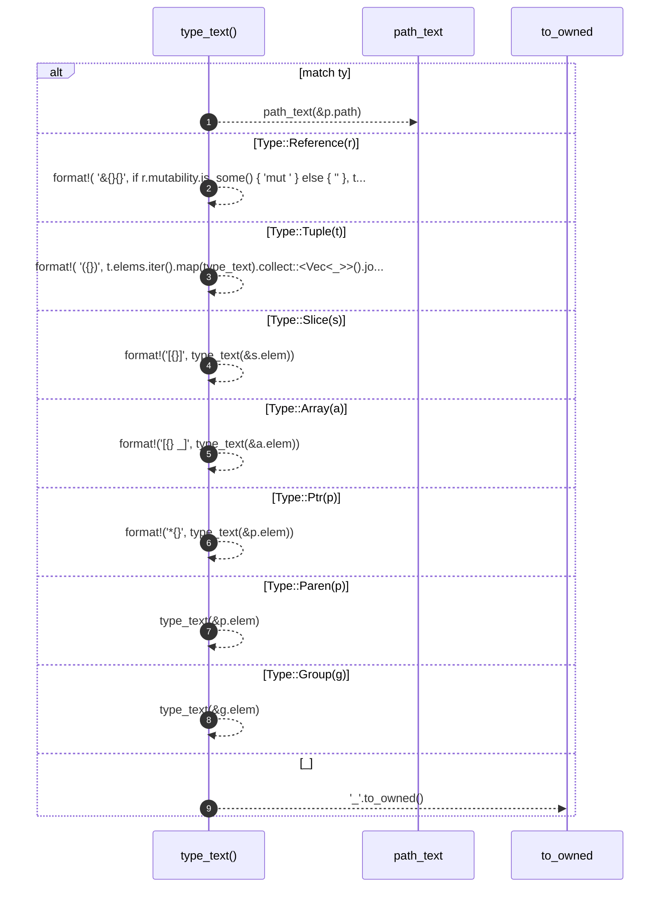

# `robby_extract::rust::type_text`

[Self-model](../../README.md) · [rust](index.md)

| | |
|---|---|
| kind | `code.function` |
| signature | `fn type_text(ty: &Type) -> String` |
| location | [`crates/robby-extract/src/rust.rs:435`](../../../../crates/robby-extract/src/rust.rs#L435) |
| provenance | extractor · confidence 1.00 |

> Render a type just well enough to disambiguate impl blocks.
> 
> `impl From<&str> for Kind` and `impl From<String> for Kind` must not collide,
> so generic arguments are part of the identity.

```rust
/// Render a type just well enough to disambiguate impl blocks.
///
/// `impl From<&str> for Kind` and `impl From<String> for Kind` must not collide,
/// so generic arguments are part of the identity.
fn type_text(ty: &Type) -> String {
    match ty {
        Type::Path(p) => path_text(&p.path),
        Type::Reference(r) => format!(
            "&{}{}",
            if r.mutability.is_some() { "mut " } else { "" },
            type_text(&r.elem)
        ),
        Type::Tuple(t) => format!(
            "({})",
            t.elems.iter().map(type_text).collect::<Vec<_>>().join(", ")
        ),
        Type::Slice(s) => format!("[{}]", type_text(&s.elem)),
        Type::Array(a) => format!("[{}; _]", type_text(&a.elem)),
        Type::Ptr(p) => format!("*{}", type_text(&p.elem)),
        Type::Paren(p) => type_text(&p.elem),
        Type::Group(g) => type_text(&g.elem),
        _ => "_".to_owned(),
    }
}
```



9 steps · 0 observed · 9 possible only

**Edges**

- calls → [`robby_extract::rust::path_text`](path-text.md)
- calls → [`robby_extract::rust::type_text`](type-text.md)
- calls → [`robby_extract::rust::type_text`](type-text.md)

## References

- calls → [`robby_extract::rust`](index.md) — path_text

## Referenced by

- calls ← [`robby_extract::rust::path_text`](path-text.md)
- calls ← [`robby_extract::rust::walk_items`](walk-items.md)

