# `robby_extract::rust::walk_expr`

[Self-model](../../README.md) · [rust](index.md)

| | |
|---|---|
| kind | `code.function` |
| signature | `fn walk_expr(builder: &mut ProcBuilder<'_, '_>, expr: &Expr)` |
| location | [`crates/robby-extract/src/rust.rs:652`](../../../../crates/robby-extract/src/rust.rs#L652) |
| provenance | extractor · confidence 1.00 |

```rust
fn walk_expr(builder: &mut ProcBuilder<'_, '_>, expr: &Expr) {
    match expr {
        Expr::Call(call) => {
            let span = span_of(expr, builder.ctx);
            let display = callee_display(&call.func);
            let key = callee_name(&call.func);
            let label = label_of(builder.ctx, span.clone());
            // Walk the callee expression (e.g. `(get_fn())()` ) and args for nested calls.
            walk_expr(builder, &call.func);
            for arg in &call.args {
                walk_expr(builder, arg);
            }
            builder.emit(&display, label, StepKind::Call, span.clone());
            builder.pending.push(PendingCall {
                from: NodeId::symbol("rust", &builder.me_id),
                name: key,
                span,
            });
        }
        Expr::MethodCall(m) => {
            let span = span_of(expr, builder.ctx);
            let name = m.method.to_string();
            let label = label_of(builder.ctx, span.clone());
            walk_expr(builder, &m.receiver);
            for arg in &m.args {
                walk_expr(builder, arg);
            }
            builder.emit(&name, label, StepKind::Call, span.clone());
            builder.pending.push(PendingCall {
                from: NodeId::symbol("rust", &builder.me_id),
                name,
                span,
            });
        }
        Expr::If(if_expr) => {
            walk_expr(builder, &if_expr.cond);
            let cond = label_of(builder.ctx, span_of(&if_expr.cond, builder.ctx));
            builder.push_block(BlockKind::Alt, cond);
            walk_stmts(builder, &if_expr.then_branch.stmts);
            if let Some((_, else_expr)) = &if_expr.else_branch {
                builder.branch("else".to_owned());
                walk_expr(builder, else_expr);
            }
            builder.pop_block();
        }
        Expr::ForLoop(f) => {
            walk_expr(builder, &f.expr);
            let label = label_of(builder.ctx, span_of(&f.expr, builder.ctx));
            builder.push_block(BlockKind::Loop, label);
            walk_stmts(builder, &f.body.stmts);
            builder.pop_block();
        }
        Expr::While(w) => {
            walk_expr(builder, &w.cond);
            let label = label_of(builder.ctx, span_of(&w.cond, builder.ctx));
            builder.push_block(BlockKind::Loop, label);
            walk_stmts(builder, &w.body.stmts);
            builder.pop_block();
        }
        Expr::Loop(l) => {
            builder.push_block(BlockKind::Loop, "loop".to_owned());
            walk_stmts(builder, &l.body.stmts);
            builder.pop_block();
        }
        Expr::Match(m) => {
            // Scrutinee holds real calls (`match run() { ... }`) — walk it.
            walk_expr(builder, &m.expr);
            let label = label_of(builder.ctx, span_of(&m.expr, builder.ctx));
            builder.push_block(BlockKind::Alt, format!("match {label}"));
            for (i, arm) in m.arms.iter().enumerate() {
                if i > 0 {
                    let pat = label_of(builder.ctx, span_of(&arm.pat, builder.ctx));
                    builder.branch(pat);
                }
                walk_expr(builder, &arm.body);
            }
            builder.pop_block();
        }
        Expr::Block(b) => walk_stmts(builder, &b.block.stmts),
        Expr::Try(t) => {
            walk_expr(builder, &t.expr);
            let span = span_of(expr, builder.ctx);
            let me = builder.me.clone();
            builder.emit(&me, "? (propagate)".to_owned(), StepKind::Return, span);
        }
        Expr::Return(r) => {
            if let Some(value) = &r.expr {
                walk_expr(builder, value);
            }
            let span = span_of(expr, builder.ctx);
            let me = builder.me.clone();
            builder.emit(&me, "return".to_owned(), StepKind::Return, span);
        }
        Expr::Await(a) => {
            walk_expr(builder, &a.base);
            let span = span_of(expr, builder.ctx);
            let me = builder.me.clone();
            builder.emit(&me, "await".to_owned(), StepKind::Signal, span);
        }
        // Nested call sites inside compound expressions.
        Expr::Paren(p) => walk_expr(builder, &p.expr),
        Expr::Group(g) => walk_expr(builder, &g.expr),
        Expr::Unary(u) => walk_expr(builder, &u.expr),
        Expr::Binary(b) => {
            walk_expr(builder, &b.left);
            walk_expr(builder, &b.right);
        }
        Expr::Assign(a) => {
            walk_expr(builder, &a.left);
            walk_expr(builder, &a.right);
        }
        Expr::Field(f) => walk_expr(builder, &f.base),
        Expr::Index(i) => {
            walk_expr(builder, &i.expr);
            walk_expr(builder, &i.index);
        }
        Expr::Reference(r) => walk_expr(builder, &r.expr),
        Expr::Tuple(t) => {
            for elem in &t.elems {
                walk_expr(builder, elem);
            }
        }
        Expr::Array(a) => {
            for elem in &a.elems {
                walk_expr(builder, elem);
            }
        }
        Expr::Repeat(r) => {
            walk_expr(builder, &r.expr);
            walk_expr(builder, &r.len);
        }
        Expr::Range(r) => {
            if let Some(start) = &r.start {
                walk_expr(builder, start);
            }
            if let Some(end) = &r.end {
                walk_expr(builder, end);
            }
        }
        Expr::Cast(c) => walk_expr(builder, &c.expr),
        Expr::Let(l) => walk_expr(builder, &l.expr),
        Expr::Closure(c) => match &*c.body {
            Expr::Block(b) => walk_stmts(builder, &b.block.stmts),
            other => walk_expr(builder, other),
        },
        Expr::Async(a) => walk_stmts(builder, &a.block.stmts),
        Expr::Unsafe(u) => walk_stmts(builder, &u.block.stmts),
        Expr::Const(c) => walk_stmts(builder, &c.block.stmts),
        Expr::Struct(s) => {
            for field in &s.fields {
                walk_expr(builder, &field.expr);
            }
            if let Some(rest) = &s.rest {
                walk_expr(builder, rest);
            }
        }
        // Leaves — no process step; callers that care emit their own Call/Note.
        Expr::Path(_) | Expr::Lit(_) | Expr::Continue(_) | Expr::Break(_) => {}
        _ => {
            let span = span_of(expr, builder.ctx);
            let me = builder.me.clone();
            builder.emit(&me, label_of(builder.ctx, span.clone()), StepKind::Note, span);
        }
    }
}
```

```mermaid
sequenceDiagram
    autonumber
    participant walk_expr as walk_expr()
    participant span_of as span_of
    participant callee_display as callee_display
    participant callee_name as callee_name
    participant clone as clone
    participant label_of as label_of
    participant emit as emit
    participant NodeId__symbol as NodeId::symbol
    participant push as push
    participant to_string as to_string
    participant push_block as push_block
    participant walk_stmts as walk_stmts
    participant to_owned as to_owned
    participant branch as branch
    participant pop_block as pop_block
    participant iter as iter
    participant enumerate as enumerate
    alt match expr
    walk_expr-->>span_of: span_of(expr, builder.ctx)
    walk_expr-->>callee_display: callee_display(&call.func)
    walk_expr-->>callee_name: callee_name(&call.func)
    walk_expr-->>clone: span.clone()
    walk_expr-->>label_of: label_of(builder.ctx, span.clone())
    walk_expr-->>walk_expr: walk_expr(builder, &call.func)
    loop &call.args
    walk_expr-->>walk_expr: walk_expr(builder, arg)
    end
    walk_expr-->>clone: span.clone()
    walk_expr-->>emit: builder.emit(&display, label, StepKind::Call, span.clone())
    walk_expr-->>NodeId__symbol: NodeId::symbol('rust', &builder.me_id)
    walk_expr-->>push: builder.pending.push(PendingCall { from: NodeId::symbol('rust', &buil...
    else Expr::MethodCall(m)
    walk_expr-->>span_of: span_of(expr, builder.ctx)
    walk_expr-->>to_string: m.method.to_string()
    walk_expr-->>clone: span.clone()
    walk_expr-->>label_of: label_of(builder.ctx, span.clone())
    walk_expr-->>walk_expr: walk_expr(builder, &m.receiver)
    loop &m.args
    walk_expr-->>walk_expr: walk_expr(builder, arg)
    end
    walk_expr-->>clone: span.clone()
    walk_expr-->>emit: builder.emit(&name, label, StepKind::Call, span.clone())
    walk_expr-->>NodeId__symbol: NodeId::symbol('rust', &builder.me_id)
    walk_expr-->>push: builder.pending.push(PendingCall { from: NodeId::symbol('rust', &buil...
    else Expr::If(if_expr)
    walk_expr-->>walk_expr: walk_expr(builder, &if_expr.cond)
    walk_expr-->>span_of: span_of(&if_expr.cond, builder.ctx)
    walk_expr-->>label_of: label_of(builder.ctx, span_of(&if_expr.cond, builder.ctx))
    walk_expr-->>push_block: builder.push_block(BlockKind::Alt, cond)
    walk_expr-->>walk_stmts: walk_stmts(builder, &if_expr.then_branch.stmts)
    alt let Some((_, else_expr)) = &if_expr.else_branch
    walk_expr-->>to_owned: 'else'.to_owned()
    walk_expr-->>branch: builder.branch('else'.to_owned())
    walk_expr-->>walk_expr: walk_expr(builder, else_expr)
    end
    walk_expr-->>pop_block: builder.pop_block()
    else Expr::ForLoop(f)
    walk_expr-->>walk_expr: walk_expr(builder, &f.expr)
    walk_expr-->>span_of: span_of(&f.expr, builder.ctx)
    walk_expr-->>label_of: label_of(builder.ctx, span_of(&f.expr, builder.ctx))
    walk_expr-->>push_block: builder.push_block(BlockKind::Loop, label)
    walk_expr-->>walk_stmts: walk_stmts(builder, &f.body.stmts)
    walk_expr-->>pop_block: builder.pop_block()
    else Expr::While(w)
    walk_expr-->>walk_expr: walk_expr(builder, &w.cond)
    walk_expr-->>span_of: span_of(&w.cond, builder.ctx)
    walk_expr-->>label_of: label_of(builder.ctx, span_of(&w.cond, builder.ctx))
    walk_expr-->>push_block: builder.push_block(BlockKind::Loop, label)
    walk_expr-->>walk_stmts: walk_stmts(builder, &w.body.stmts)
    walk_expr-->>pop_block: builder.pop_block()
    else Expr::Loop(l)
    walk_expr-->>to_owned: 'loop'.to_owned()
    walk_expr-->>push_block: builder.push_block(BlockKind::Loop, 'loop'.to_owned())
    walk_expr-->>walk_stmts: walk_stmts(builder, &l.body.stmts)
    walk_expr-->>pop_block: builder.pop_block()
    else Expr::Match(m)
    walk_expr-->>walk_expr: walk_expr(builder, &m.expr)
    walk_expr-->>span_of: span_of(&m.expr, builder.ctx)
    walk_expr-->>label_of: label_of(builder.ctx, span_of(&m.expr, builder.ctx))
    walk_expr-->>walk_expr: format!('match {label}')
    walk_expr-->>push_block: builder.push_block(BlockKind::Alt, format!('match {label}'))
    walk_expr-->>iter: m.arms.iter()
    walk_expr-->>enumerate: m.arms.iter().enumerate()
    loop m.arms.iter().enumerate()
    alt i > 0
    walk_expr-->>span_of: span_of(&arm.pat, builder.ctx)
    walk_expr-->>label_of: label_of(builder.ctx, span_of(&arm.pat, builder.ctx))
    walk_expr-->>branch: builder.branch(pat)
    end
    walk_expr-->>walk_expr: walk_expr(builder, &arm.body)
    end
    walk_expr-->>pop_block: builder.pop_block()
    else Expr::Block(b)
    walk_expr-->>walk_stmts: walk_stmts(builder, &b.block.stmts)
    else Expr::Try(t)
    walk_expr-->>walk_expr: walk_expr(builder, &t.expr)
    walk_expr-->>span_of: span_of(expr, builder.ctx)
    walk_expr-->>clone: builder.me.clone()
    walk_expr-->>to_owned: '? (propagate)'.to_owned()
    walk_expr-->>emit: builder.emit(&me, '? (propagate)'.to_owned(), StepKind::Return, span)
    else Expr::Return(r)
    alt let Some(value) = &r.expr
    walk_expr-->>walk_expr: walk_expr(builder, value)
    end
    walk_expr-->>span_of: span_of(expr, builder.ctx)
    walk_expr-->>clone: builder.me.clone()
    walk_expr-->>to_owned: 'return'.to_owned()
    walk_expr-->>emit: builder.emit(&me, 'return'.to_owned(), StepKind::Return, span)
    else Expr::Await(a)
    walk_expr-->>walk_expr: walk_expr(builder, &a.base)
    walk_expr-->>span_of: span_of(expr, builder.ctx)
    walk_expr-->>clone: builder.me.clone()
    walk_expr-->>to_owned: 'await'.to_owned()
    walk_expr-->>emit: builder.emit(&me, 'await'.to_owned(), StepKind::Signal, span)
    else Expr::Paren(p)
    walk_expr-->>walk_expr: walk_expr(builder, &p.expr)
    else Expr::Group(g)
    walk_expr-->>walk_expr: walk_expr(builder, &g.expr)
    else Expr::Unary(u)
    walk_expr-->>walk_expr: walk_expr(builder, &u.expr)
    else Expr::Binary(b)
    walk_expr-->>walk_expr: walk_expr(builder, &b.left)
    walk_expr-->>walk_expr: walk_expr(builder, &b.right)
    else Expr::Assign(a)
    walk_expr-->>walk_expr: walk_expr(builder, &a.left)
    walk_expr-->>walk_expr: walk_expr(builder, &a.right)
    else Expr::Field(f)
    walk_expr-->>walk_expr: walk_expr(builder, &f.base)
    else Expr::Index(i)
    walk_expr-->>walk_expr: walk_expr(builder, &i.expr)
    walk_expr-->>walk_expr: walk_expr(builder, &i.index)
    else Expr::Reference(r)
    walk_expr-->>walk_expr: walk_expr(builder, &r.expr)
    else Expr::Tuple(t)
    loop &t.elems
    walk_expr-->>walk_expr: walk_expr(builder, elem)
    end
    else Expr::Array(a)
    loop &a.elems
    walk_expr-->>walk_expr: walk_expr(builder, elem)
    end
    else Expr::Repeat(r)
    walk_expr-->>walk_expr: walk_expr(builder, &r.expr)
    walk_expr-->>walk_expr: walk_expr(builder, &r.len)
    else Expr::Range(r)
    alt let Some(start) = &r.start
    walk_expr-->>walk_expr: walk_expr(builder, start)
    end
    alt let Some(end) = &r.end
    walk_expr-->>walk_expr: walk_expr(builder, end)
    end
    else Expr::Cast(c)
    walk_expr-->>walk_expr: walk_expr(builder, &c.expr)
    else Expr::Let(l)
    walk_expr-->>walk_expr: walk_expr(builder, &l.expr)
    else Expr::Closure(c)
    alt match &*c.body
    walk_expr-->>walk_stmts: walk_stmts(builder, &b.block.stmts)
    else other
    walk_expr-->>walk_expr: walk_expr(builder, other)
    end
    else Expr::Async(a)
    walk_expr-->>walk_stmts: walk_stmts(builder, &a.block.stmts)
    else Expr::Unsafe(u)
    walk_expr-->>walk_stmts: walk_stmts(builder, &u.block.stmts)
    else Expr::Const(c)
    walk_expr-->>walk_stmts: walk_stmts(builder, &c.block.stmts)
    else Expr::Struct(s)
    loop &s.fields
    walk_expr-->>walk_expr: walk_expr(builder, &field.expr)
    end
    alt let Some(rest) = &s.rest
    walk_expr-->>walk_expr: walk_expr(builder, rest)
    end
    else _
    walk_expr-->>span_of: span_of(expr, builder.ctx)
    walk_expr-->>clone: builder.me.clone()
    walk_expr-->>clone: span.clone()
    walk_expr-->>label_of: label_of(builder.ctx, span.clone())
    walk_expr-->>emit: builder.emit(&me, label_of(builder.ctx, span.clone()), StepKind::Note...
    end
```



105 steps · 0 observed · 105 possible only

**Edges**

- calls → [`robby_extract::rust::span_of`](span-of.md)
- calls → [`robby_extract::rust::callee_display`](callee-display.md)
- calls → [`robby_extract::rust::callee_name`](callee-name.md)
- calls → [`robby_extract::rust::label_of`](label-of.md)
- calls → [`robby_extract::rust::walk_expr`](walk-expr.md)
- calls → [`robby_extract::rust::walk_expr`](walk-expr.md)
- calls → [`robby_extract::rust::impl ProcBuilder<'_, '_>::emit`](index.md)
- calls → [`robby_ir::model::impl NodeId::symbol`](../../robby_ir/model/index.md)
- calls → [`robby_render::report::impl Report::push`](../../robby_render/report/index.md)
- calls → [`robby_extract::rust::span_of`](span-of.md)
- calls → [`robby_extract::rust::label_of`](label-of.md)
- calls → [`robby_extract::rust::walk_expr`](walk-expr.md)
- calls → [`robby_extract::rust::walk_expr`](walk-expr.md)
- calls → [`robby_extract::rust::impl ProcBuilder<'_, '_>::emit`](index.md)
- calls → [`robby_ir::model::impl NodeId::symbol`](../../robby_ir/model/index.md)
- calls → [`robby_render::report::impl Report::push`](../../robby_render/report/index.md)
- calls → [`robby_extract::rust::walk_expr`](walk-expr.md)
- calls → [`robby_extract::rust::span_of`](span-of.md)
- calls → [`robby_extract::rust::label_of`](label-of.md)
- calls → [`robby_extract::rust::impl ProcBuilder<'_, '_>::push_block`](index.md)
- calls → [`robby_extract::rust::walk_stmts`](walk-stmts.md)
- calls → [`robby_extract::rust::impl ProcBuilder<'_, '_>::branch`](index.md)
- calls → [`robby_extract::rust::walk_expr`](walk-expr.md)
- calls → [`robby_extract::rust::impl ProcBuilder<'_, '_>::pop_block`](index.md)
- calls → [`robby_extract::rust::walk_expr`](walk-expr.md)
- calls → [`robby_extract::rust::span_of`](span-of.md)
- calls → [`robby_extract::rust::label_of`](label-of.md)
- calls → [`robby_extract::rust::impl ProcBuilder<'_, '_>::push_block`](index.md)
- calls → [`robby_extract::rust::walk_stmts`](walk-stmts.md)
- calls → [`robby_extract::rust::impl ProcBuilder<'_, '_>::pop_block`](index.md)
- calls → [`robby_extract::rust::walk_expr`](walk-expr.md)
- calls → [`robby_extract::rust::span_of`](span-of.md)
- calls → [`robby_extract::rust::label_of`](label-of.md)
- calls → [`robby_extract::rust::impl ProcBuilder<'_, '_>::push_block`](index.md)
- calls → [`robby_extract::rust::walk_stmts`](walk-stmts.md)
- calls → [`robby_extract::rust::impl ProcBuilder<'_, '_>::pop_block`](index.md)
- calls → [`robby_extract::rust::impl ProcBuilder<'_, '_>::push_block`](index.md)
- calls → [`robby_extract::rust::walk_stmts`](walk-stmts.md)
- calls → [`robby_extract::rust::impl ProcBuilder<'_, '_>::pop_block`](index.md)
- calls → [`robby_extract::rust::walk_expr`](walk-expr.md)
- calls → [`robby_extract::rust::span_of`](span-of.md)
- calls → [`robby_extract::rust::label_of`](label-of.md)
- calls → [`robby_extract::rust::impl ProcBuilder<'_, '_>::push_block`](index.md)
- calls → [`robby_extract::rust::span_of`](span-of.md)
- calls → [`robby_extract::rust::label_of`](label-of.md)
- calls → [`robby_extract::rust::impl ProcBuilder<'_, '_>::branch`](index.md)
- calls → [`robby_extract::rust::walk_expr`](walk-expr.md)
- calls → [`robby_extract::rust::impl ProcBuilder<'_, '_>::pop_block`](index.md)
- calls → [`robby_extract::rust::walk_stmts`](walk-stmts.md)
- calls → [`robby_extract::rust::walk_expr`](walk-expr.md)
- calls → [`robby_extract::rust::span_of`](span-of.md)
- calls → [`robby_extract::rust::impl ProcBuilder<'_, '_>::emit`](index.md)
- calls → [`robby_extract::rust::walk_expr`](walk-expr.md)
- calls → [`robby_extract::rust::span_of`](span-of.md)
- calls → [`robby_extract::rust::impl ProcBuilder<'_, '_>::emit`](index.md)
- calls → [`robby_extract::rust::walk_expr`](walk-expr.md)
- calls → [`robby_extract::rust::span_of`](span-of.md)
- calls → [`robby_extract::rust::impl ProcBuilder<'_, '_>::emit`](index.md)
- calls → [`robby_extract::rust::walk_expr`](walk-expr.md)
- calls → [`robby_extract::rust::walk_expr`](walk-expr.md)
- calls → [`robby_extract::rust::walk_expr`](walk-expr.md)
- calls → [`robby_extract::rust::walk_expr`](walk-expr.md)
- calls → [`robby_extract::rust::walk_expr`](walk-expr.md)
- calls → [`robby_extract::rust::walk_expr`](walk-expr.md)
- calls → [`robby_extract::rust::walk_expr`](walk-expr.md)
- calls → [`robby_extract::rust::walk_expr`](walk-expr.md)
- calls → [`robby_extract::rust::walk_expr`](walk-expr.md)
- calls → [`robby_extract::rust::walk_expr`](walk-expr.md)
- calls → [`robby_extract::rust::walk_expr`](walk-expr.md)
- calls → [`robby_extract::rust::walk_expr`](walk-expr.md)
- calls → [`robby_extract::rust::walk_expr`](walk-expr.md)
- calls → [`robby_extract::rust::walk_expr`](walk-expr.md)
- calls → [`robby_extract::rust::walk_expr`](walk-expr.md)
- calls → [`robby_extract::rust::walk_expr`](walk-expr.md)
- calls → [`robby_extract::rust::walk_expr`](walk-expr.md)
- calls → [`robby_extract::rust::walk_expr`](walk-expr.md)
- calls → [`robby_extract::rust::walk_expr`](walk-expr.md)
- calls → [`robby_extract::rust::walk_stmts`](walk-stmts.md)
- calls → [`robby_extract::rust::walk_expr`](walk-expr.md)
- calls → [`robby_extract::rust::walk_stmts`](walk-stmts.md)
- calls → [`robby_extract::rust::walk_stmts`](walk-stmts.md)
- calls → [`robby_extract::rust::walk_stmts`](walk-stmts.md)
- calls → [`robby_extract::rust::walk_expr`](walk-expr.md)
- calls → [`robby_extract::rust::walk_expr`](walk-expr.md)
- calls → [`robby_extract::rust::span_of`](span-of.md)
- calls → [`robby_extract::rust::label_of`](label-of.md)
- calls → [`robby_extract::rust::impl ProcBuilder<'_, '_>::emit`](index.md)

## References

- calls → [`robby_extract::rust`](index.md) — 9 items
- calls → [`robby_ir::model`](../../robby_ir/model/index.md) — symbol
- calls → [`robby_render::report`](../../robby_render/report/index.md) — push

## Referenced by

- calls ← [`robby_extract::rust::walk_stmts`](walk-stmts.md)

