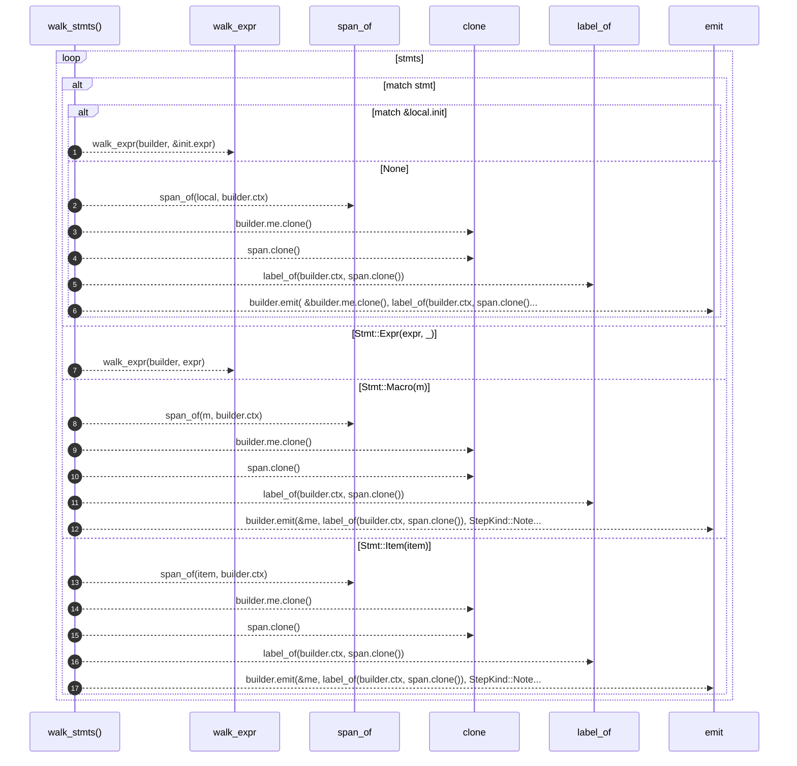

# `robby_extract::rust::walk_stmts`

[Self-model](../../README.md) · [rust](index.md)

| | |
|---|---|
| kind | `code.function` |
| signature | `fn walk_stmts(builder: &mut ProcBuilder<'_, '_>, stmts: &[Stmt])` |
| location | [`crates/robby-extract/src/rust.rs:622`](../../../../crates/robby-extract/src/rust.rs#L622) |
| provenance | extractor · confidence 1.00 |

```rust
fn walk_stmts(builder: &mut ProcBuilder<'_, '_>, stmts: &[Stmt]) {
    for stmt in stmts {
        match stmt {
            Stmt::Local(local) => match &local.init {
                Some(init) => walk_expr(builder, &init.expr),
                None => {
                    let span = span_of(local, builder.ctx);
                    builder.emit(
                        &builder.me.clone(),
                        label_of(builder.ctx, span.clone()),
                        StepKind::Note,
                        span,
                    );
                }
            },
            Stmt::Expr(expr, _) => walk_expr(builder, expr),
            Stmt::Macro(m) => {
                let span = span_of(m, builder.ctx);
                let me = builder.me.clone();
                builder.emit(&me, label_of(builder.ctx, span.clone()), StepKind::Note, span);
            }
            Stmt::Item(item) => {
                let span = span_of(item, builder.ctx);
                let me = builder.me.clone();
                builder.emit(&me, label_of(builder.ctx, span.clone()), StepKind::Note, span);
            }
        }
    }
}
```



17 steps · 0 observed · 17 possible only

**Edges**

- calls → [`robby_extract::rust::walk_expr`](walk-expr.md)
- calls → [`robby_extract::rust::span_of`](span-of.md)
- calls → [`robby_extract::rust::label_of`](label-of.md)
- calls → [`robby_extract::rust::impl ProcBuilder<'_, '_>::emit`](index.md)
- calls → [`robby_extract::rust::walk_expr`](walk-expr.md)
- calls → [`robby_extract::rust::span_of`](span-of.md)
- calls → [`robby_extract::rust::label_of`](label-of.md)
- calls → [`robby_extract::rust::impl ProcBuilder<'_, '_>::emit`](index.md)
- calls → [`robby_extract::rust::span_of`](span-of.md)
- calls → [`robby_extract::rust::label_of`](label-of.md)
- calls → [`robby_extract::rust::impl ProcBuilder<'_, '_>::emit`](index.md)

## References

- calls → [`robby_extract::rust`](index.md) — emit, label_of, span_of, walk_expr

## Referenced by

- calls ← [`robby_extract::rust::build_process_sig`](build-process-sig.md)
- calls ← [`robby_extract::rust::walk_expr`](walk-expr.md)

