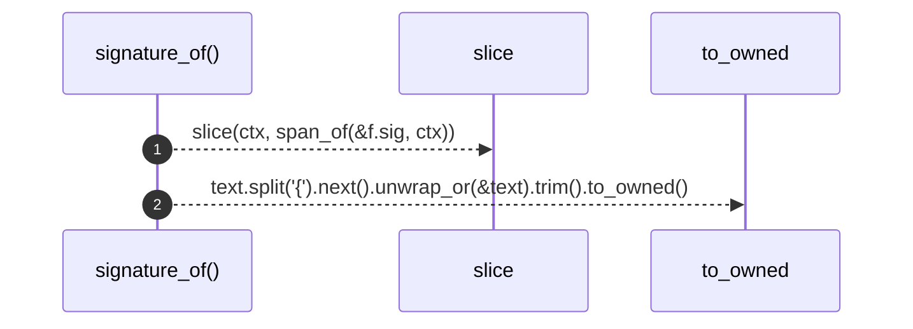

# `robby_extract::signature_of`

[Self-model](../README.md) · [robby_extract](index.md)

| | |
|---|---|
| kind | `code.function` |
| signature | `fn signature_of(f: &syn::ItemFn, ctx: &Ctx<'_>) -> String` |
| location | [`crates/robby-extract/src/lib.rs:393`](../../../crates/robby-extract/src/lib.rs#L393) |
| provenance | extractor · confidence 1.00 |

```rust
fn signature_of(f: &syn::ItemFn, ctx: &Ctx<'_>) -> String {
    let text = slice(ctx, span_of(&f.sig, ctx));
    text.split('{').next().unwrap_or(&text).trim().to_owned()
}
```



2 steps · 0 observed · 2 possible only

**Edges**

- calls → [`robby_extract::slice`](slice.md)

