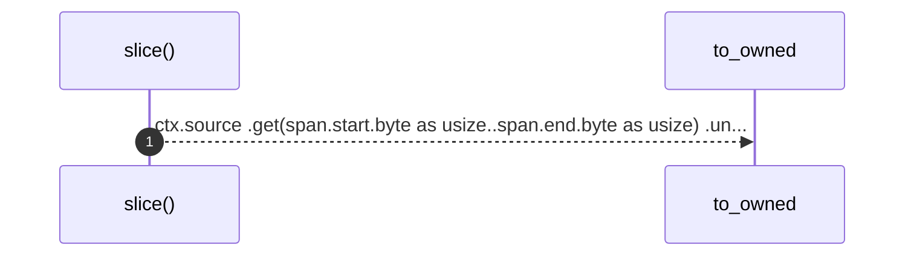

# `robby_extract::slice`

[Self-model](../README.md) · [robby_extract](index.md)

| | |
|---|---|
| kind | `code.function` |
| signature | `fn slice(ctx: &Ctx<'_>, span: Span) -> String` |
| location | [`crates/robby-extract/src/lib.rs:523`](../../../crates/robby-extract/src/lib.rs#L523) |
| provenance | extractor · confidence 1.00 |

```rust
fn slice(ctx: &Ctx<'_>, span: Span) -> String {
    ctx.source
        .get(span.start.byte as usize..span.end.byte as usize)
        .unwrap_or("")
        .to_owned()
}
```



1 steps · 0 observed · 1 possible only

