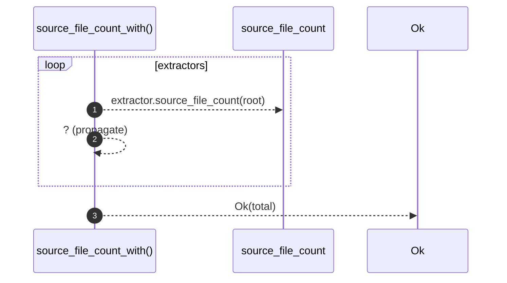

# `robby_extract::source_file_count_with`

[Self-model](../README.md) · [robby_extract](index.md)

| | |
|---|---|
| kind | `code.function` |
| signature | `fn source_file_count_with<'a>(     root: &Path,     extractors: impl IntoIterator<Item = &'a dyn LanguageExtractor>, ) -> Result<usize>` |
| location | [`crates/robby-extract/src/lib.rs:92`](../../../crates/robby-extract/src/lib.rs#L92) |
| provenance | extractor · confidence 1.00 |

```rust
pub fn source_file_count_with<'a>(
    root: &Path,
    extractors: impl IntoIterator<Item = &'a dyn LanguageExtractor>,
) -> Result<usize> {
    let mut total = 0;
    for extractor in extractors {
        total += extractor.source_file_count(root)?;
    }
    Ok(total)
}
```



3 steps · 0 observed · 3 possible only

**Edges**

- calls → [`robby_extract::source_file_count`](source-file-count.md)

## References

- calls → [`robby_extract`](index.md) — source_file_count

