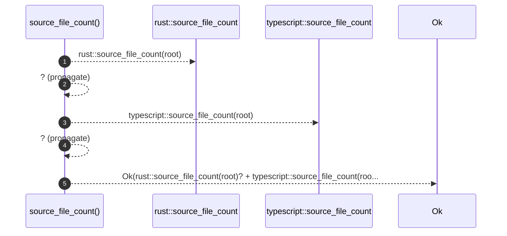

# `robby_extract::source_file_count`

[Self-model](../README.md) · [robby_extract](index.md)

| | |
|---|---|
| kind | `code.function` |
| signature | `fn source_file_count(root: &Path) -> Result<usize>` |
| location | [`crates/robby-extract/src/lib.rs:26`](../../../crates/robby-extract/src/lib.rs#L26) |
| provenance | extractor · confidence 1.00 |

> Count of source files (`.rs` + TypeScript) the extractor considers part of
> the workspace.

```rust
/// Count of source files (`.rs` + TypeScript) the extractor considers part of
/// the workspace.
pub fn source_file_count(root: &Path) -> Result<usize> {
    Ok(rust::source_file_count(root)? + typescript::source_file_count(root)?)
}
```



5 steps · 0 observed · 5 possible only

**Edges**

- calls → [`robby_extract::source_file_count`](source-file-count.md)
- calls → [`robby_extract::source_file_count`](source-file-count.md)

## Referenced by

- calls ← [`robby_extract::test_extract::every_source_file_is_declared`](test_extract/every-source-file-is-declared.md)

