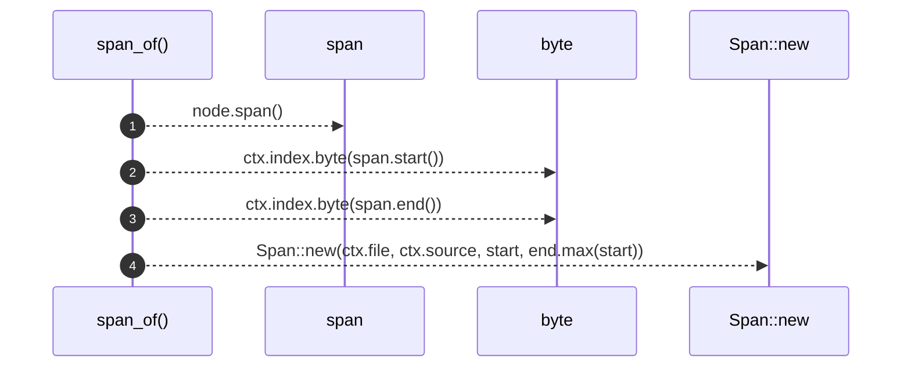

# `robby_extract::span_of`

[Self-model](../README.md) · [robby_extract](index.md)

| | |
|---|---|
| kind | `code.function` |
| signature | `fn span_of<T: Spanned>(node: &T, ctx: &Ctx<'_>) -> Span` |
| location | [`crates/robby-extract/src/lib.rs:516`](../../../crates/robby-extract/src/lib.rs#L516) |
| provenance | extractor · confidence 1.00 |

```rust
fn span_of<T: Spanned>(node: &T, ctx: &Ctx<'_>) -> Span {
    let span = node.span();
    let start = ctx.index.byte(span.start());
    let end = ctx.index.byte(span.end());
    Span::new(ctx.file, ctx.source, start, end.max(start))
}
```



4 steps · 0 observed · 4 possible only

**Edges**

- calls → [`robby_ir::test_coverage::span`](../robby_ir/test_coverage/span.md)
- calls → [`robby_extract::impl LineIndex::byte`](index.md)
- calls → [`robby_extract::impl LineIndex::byte`](index.md)
- calls → [`robby_extract::impl LineIndex::new`](index.md)

