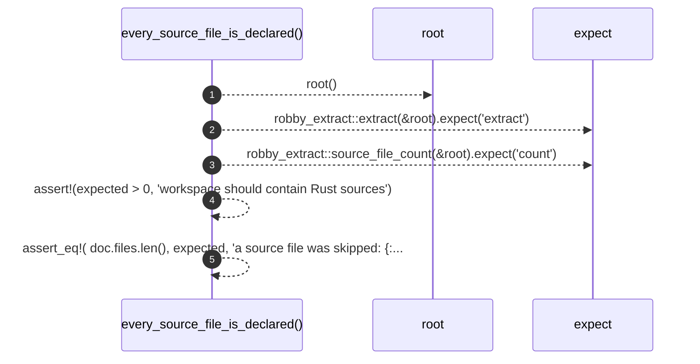

# `robby_extract::test_extract::every_source_file_is_declared`

[Self-model](../../README.md) · [test_extract](index.md)

| | |
|---|---|
| kind | `code.function` |
| signature | `fn every_source_file_is_declared()` |
| location | [`crates/robby-extract/tests/extract.rs:12`](../../../../crates/robby-extract/tests/extract.rs#L12) |
| provenance | extractor · confidence 1.00 |

```rust
#[test]
fn every_source_file_is_declared() {
    let root = root();
    let doc = robby_extract::extract(&root).expect("extract");
    let expected = robby_extract::source_file_count(&root).expect("count");

    assert!(expected > 0, "workspace should contain Rust sources");
    assert_eq!(
        doc.files.len(),
        expected,
        "a source file was skipped: {:?}",
        doc.files
    );
}
```



5 steps · 0 observed · 5 possible only

**Edges**

- calls → [`robby_extract::test_extract::root`](root.md)

