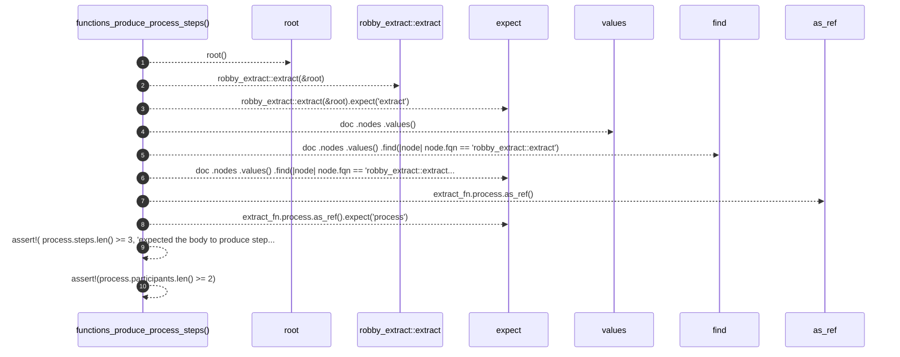

# `robby_extract::test_extract::functions_produce_process_steps`

[Self-model](../../README.md) · [test_extract](index.md)

| | |
|---|---|
| kind | `code.function` |
| signature | `fn functions_produce_process_steps()` |
| location | [`crates/robby-extract/tests/extract.rs:48`](../../../../crates/robby-extract/tests/extract.rs#L48) |
| provenance | extractor · confidence 1.00 |

```rust
#[test]
fn functions_produce_process_steps() {
    let root = root();
    let doc = robby_extract::extract(&root).expect("extract");

    let extract_fn = doc
        .nodes
        .values()
        .find(|node| node.fqn == "robby_extract::extract")
        .expect("extract fn");

    let process = extract_fn.process.as_ref().expect("process");
    assert!(
        process.steps.len() >= 3,
        "expected the body to produce steps, got {}",
        process.steps.len()
    );
    assert!(process.participants.len() >= 2);
}
```



10 steps · 0 observed · 10 possible only

**Edges**

- calls → [`robby_extract::test_extract::root`](root.md)
- calls → [`robby_extract::extract`](../extract.md)

## References

- calls → [`robby_extract`](../index.md) — extract
- calls → [`robby_extract::test_extract`](index.md) — root

