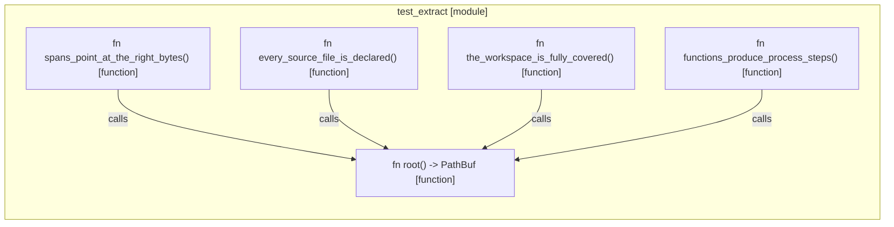

# `robby_extract::test_extract`

[Self-model](../../README.md) · [robby_extract](../index.md)

| | |
|---|---|
| kind | `code.module` |
| provenance | extractor · confidence 1.00 |
| nodes | 8 |

## Items

| Item | Kind | Steps | Location |
|---|---|---:|---|
| [`root`](root.md) | `code.function` | 1 | `crates/robby-extract/tests/extract.rs:8:1` |
| [`every_source_file_is_declared`](every-source-file-is-declared.md) | `code.function` | 5 | `crates/robby-extract/tests/extract.rs:12:1` |
| [`the_workspace_is_fully_covered`](the-workspace-is-fully-covered.md) | `code.function` | 8 | `crates/robby-extract/tests/extract.rs:27:1` |
| [`functions_produce_process_steps`](functions-produce-process-steps.md) | `code.function` | 6 | `crates/robby-extract/tests/extract.rs:51:1` |
| [`spans_point_at_the_right_bytes`](spans-point-at-the-right-bytes.md) | `code.function` | 8 | `crates/robby-extract/tests/extract.rs:71:1` |

## Imports

- `use std::collections::BTreeMap;`
- `use std::path::PathBuf;`

