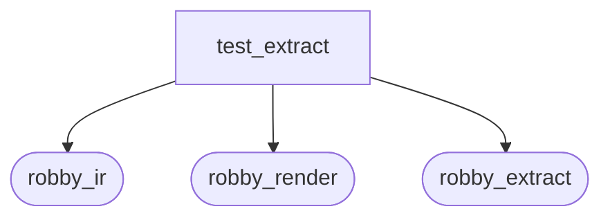
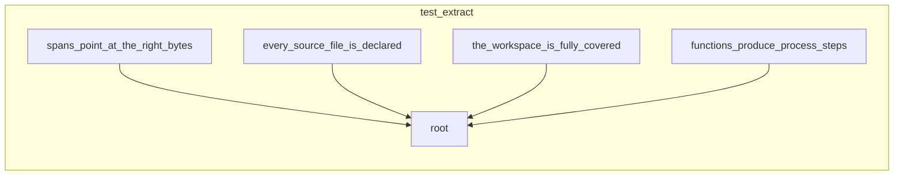

# `robby_extract::test_extract`

[Self-model](../../README.md) · [robby_extract](../index.md)

| | |
|---|---|
| kind | `code.module` |
| provenance | extractor · confidence 1.00 |
| nodes | 8 |

## Package diagram

## Module coupling

## Dependency matrix

| | test_extract | robby_ir | robby_render | robby_extract |
|---|---:|---:|---:|---:|
| **test_extract** | · | 4 | 1 | 6 |
| **robby_ir** | | · | | |
| **robby_render** | | | · | |
| **robby_extract** | | | | · |
## References

- calls → [`robby_extract`](../index.md) — extract, source_file_count
- calls → [`robby_extract::rust`](../rust/index.md) — new
- calls → [`robby_ir::coverage`](../../robby_ir/coverage/index.md) — document_coverage, failures
- calls → [`robby_ir::kind`](../../robby_ir/kind/index.md) — from
- calls → [`robby_ir::model`](../../robby_ir/model/index.md) — insert
- calls → [`robby_render::view::select`](../../robby_render/view/select/index.md) — collect

## Items

| Item | Kind | Steps | Location |
|---|---|---:|---|
| [`root`](root.md) | `code.function` | 3 | `crates/robby-extract/tests/extract.rs:8:1` |
| [`every_source_file_is_declared`](every-source-file-is-declared.md) | `code.function` | 7 | `crates/robby-extract/tests/extract.rs:12:1` |
| [`the_workspace_is_fully_covered`](the-workspace-is-fully-covered.md) | `code.function` | 16 | `crates/robby-extract/tests/extract.rs:27:1` |
| [`functions_produce_process_steps`](functions-produce-process-steps.md) | `code.function` | 10 | `crates/robby-extract/tests/extract.rs:51:1` |
| [`spans_point_at_the_right_bytes`](spans-point-at-the-right-bytes.md) | `code.function` | 13 | `crates/robby-extract/tests/extract.rs:71:1` |

## Imports

- `use std::collections::BTreeMap;`
- `use std::path::PathBuf;`

