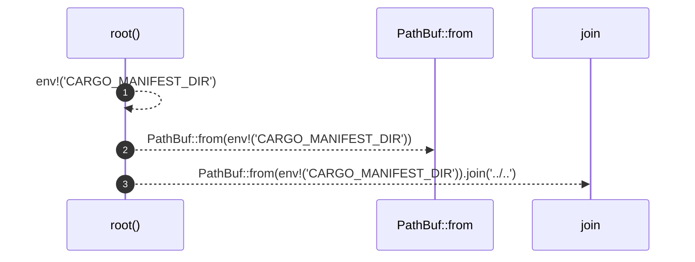

# `robby_extract::test_extract::root`

[Self-model](../../README.md) · [test_extract](index.md)

| | |
|---|---|
| kind | `code.function` |
| signature | `fn root() -> PathBuf` |
| location | [`crates/robby-extract/tests/extract.rs:8`](../../../../crates/robby-extract/tests/extract.rs#L8) |
| provenance | extractor · confidence 1.00 |

```rust
fn root() -> PathBuf {
    PathBuf::from(env!("CARGO_MANIFEST_DIR")).join("../..")
}
```



3 steps · 0 observed · 3 possible only

**Edges**

- calls → [`robby_ir::kind::impl From<&str> for Kind::from`](../../robby_ir/kind/index.md)

## References

- calls → [`robby_ir::kind`](../../robby_ir/kind/index.md) — from

## Referenced by

- calls ← [`robby_extract::test_extract::every_source_file_is_declared`](every-source-file-is-declared.md)
- calls ← [`robby_extract::test_extract::functions_produce_process_steps`](functions-produce-process-steps.md)
- calls ← [`robby_extract::test_extract::spans_point_at_the_right_bytes`](spans-point-at-the-right-bytes.md)
- calls ← [`robby_extract::test_extract::the_workspace_is_fully_covered`](the-workspace-is-fully-covered.md)

