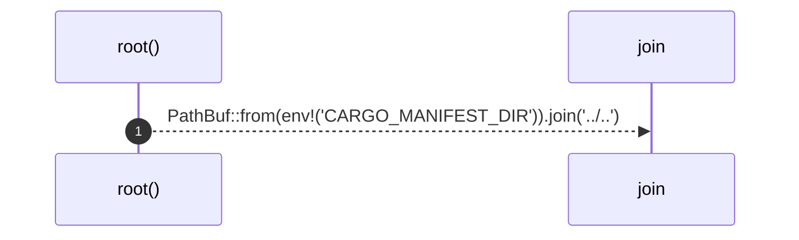

# `robby_extract::test_extract::root`

[Self-model](../../README.md) · [test_extract](index.md)

| | |
|---|---|
| kind | `code.function` |
| signature | `fn root() -> PathBuf` |
| location | [`crates/robby-extract/tests/extract.rs:8`](../../../../crates/robby-extract/tests/extract.rs#L8) |
| provenance | extractor · confidence 1.00 |

```rust
fn root() -> PathBuf {
    PathBuf::from(env!("CARGO_MANIFEST_DIR")).join("../..")
}
```



1 steps · 0 observed · 1 possible only

