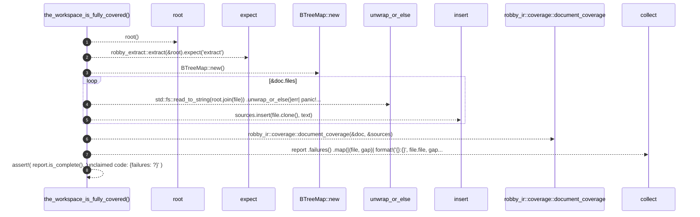

# `robby_extract::test_extract::the_workspace_is_fully_covered`

[Self-model](../../README.md) · [test_extract](index.md)

| | |
|---|---|
| kind | `code.function` |
| signature | `fn the_workspace_is_fully_covered()` |
| location | [`crates/robby-extract/tests/extract.rs:27`](../../../../crates/robby-extract/tests/extract.rs#L27) |
| provenance | extractor · confidence 1.00 |

```rust
#[test]
fn the_workspace_is_fully_covered() {
    let root = root();
    let doc = robby_extract::extract(&root).expect("extract");

    let mut sources = BTreeMap::new();
    for file in &doc.files {
        let text = std::fs::read_to_string(root.join(file))
            .unwrap_or_else(|err| panic!("reading {file}: {err}"));
        sources.insert(file.clone(), text);
    }

    let report = robby_ir::coverage::document_coverage(&doc, &sources);
    let failures: Vec<String> = report
        .failures()
        .map(|(file, gap)| format!("{}:{}", file.file, gap.span.location()))
        .collect();

    assert!(
        report.is_complete(),
        "unclaimed code: {failures:#?}"
    );
}
```



8 steps · 0 observed · 8 possible only

**Edges**

- calls → [`robby_extract::test_extract::root`](root.md)
- calls → [`robby_extract::impl LineIndex::new`](../index.md)
- calls → [`robby_ir::model::impl Document::insert`](../../robby_ir/model/index.md)
- calls → [`robby_ir::coverage::document_coverage`](../../robby_ir/coverage/document-coverage.md)

