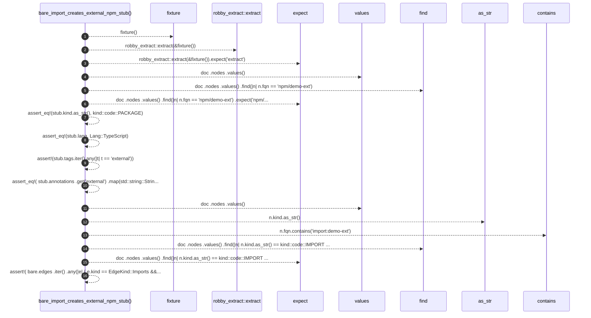

# `robby_extract::test_typescript::bare_import_creates_external_npm_stub`

[Self-model](../../README.md) · [test_typescript](index.md)

| | |
|---|---|
| kind | `code.function` |
| signature | `fn bare_import_creates_external_npm_stub()` |
| location | [`crates/robby-extract/tests/typescript.rs:83`](../../../../crates/robby-extract/tests/typescript.rs#L83) |
| provenance | extractor · confidence 1.00 |

```rust
#[test]
fn bare_import_creates_external_npm_stub() {
    let doc = robby_extract::extract(&fixture()).expect("extract");

    let stub = doc
        .nodes
        .values()
        .find(|n| n.fqn == "npm/demo-ext")
        .expect("npm/demo-ext stub");
    assert_eq!(stub.kind.as_str(), kind::code::PACKAGE);
    assert_eq!(stub.lang, Lang::TypeScript);
    assert!(stub.tags.iter().any(|t| t == "external"));
    assert_eq!(
        stub.annotations
            .get("external")
            .map(std::string::String::as_str),
        Some("true")
    );

    let bare = doc
        .nodes
        .values()
        .find(|n| n.kind.as_str() == kind::code::IMPORT && n.fqn.contains("import:demo-ext"))
        .expect("bare import");
    assert!(
        bare.edges
            .iter()
            .any(|e| { e.kind == EdgeKind::Imports && e.to == stub.id }),
        "bare import should edge to stub: {:?}",
        bare.edges
    );
}
```



16 steps · 0 observed · 16 possible only

**Edges**

- calls → [`robby_extract::test_typescript::fixture`](fixture.md)
- calls → [`robby_extract::extract`](../extract.md)
- calls → [`robby_ir::kind::impl Kind::as_str`](../../robby_ir/kind/index.md)
- calls → [`robby_render::view::scene::impl WorldRect::contains`](../../robby_render/view/scene/index.md)

## References

- calls → [`robby_extract`](../index.md) — extract
- calls → [`robby_extract::test_typescript`](index.md) — fixture
- calls → [`robby_ir::kind`](../../robby_ir/kind/index.md) — as_str
- calls → [`robby_render::view::scene`](../../robby_render/view/scene/index.md) — contains

