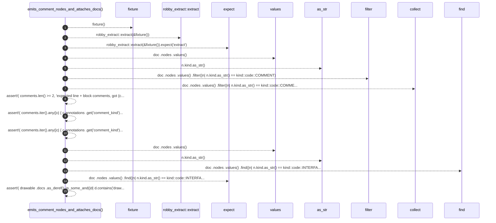

# `robby_extract::test_typescript::emits_comment_nodes_and_attaches_docs`

[Self-model](../../README.md) · [test_typescript](index.md)

| | |
|---|---|
| kind | `code.function` |
| signature | `fn emits_comment_nodes_and_attaches_docs()` |
| location | [`crates/robby-extract/tests/typescript.rs:116`](../../../../crates/robby-extract/tests/typescript.rs#L116) |
| provenance | extractor · confidence 1.00 |

```rust
#[test]
fn emits_comment_nodes_and_attaches_docs() {
    let doc = robby_extract::extract(&fixture()).expect("extract");

    let comments: Vec<_> = doc
        .nodes
        .values()
        .filter(|n| n.kind.as_str() == kind::code::COMMENT)
        .collect();
    assert!(
        comments.len() >= 2,
        "expected line + block comments, got {comments:?}"
    );
    assert!(
        comments.iter().any(|c| {
            c.annotations
                .get("comment_kind")
                .map(std::string::String::as_str)
                == Some("block")
                && c.docs.as_deref().is_some_and(|d| d.contains("drawable"))
        }),
        "missing JSDoc block: {comments:?}"
    );
    assert!(
        comments.iter().any(|c| {
            c.annotations
                .get("comment_kind")
                .map(std::string::String::as_str)
                == Some("line")
                && c.docs.as_deref().is_some_and(|d| d.contains("canvas"))
        }),
        "missing line comment: {comments:?}"
    );

    let drawable = doc
        .nodes
        .values()
        .find(|n| n.kind.as_str() == kind::code::INTERFACE && n.name == "Drawable")
        .expect("Drawable");
    assert!(
        drawable
            .docs
            .as_deref()
            .is_some_and(|d| d.contains("drawable")),
        "JSDoc should attach to Drawable: {:?}",
        drawable.docs
    );
}
```



15 steps · 0 observed · 15 possible only

**Edges**

- calls → [`robby_extract::test_typescript::fixture`](fixture.md)
- calls → [`robby_extract::extract`](../extract.md)
- calls → [`robby_ir::kind::impl Kind::as_str`](../../robby_ir/kind/index.md)
- calls → [`robby_render::view::select::collect`](../../robby_render/view/select/collect.md)
- calls → [`robby_ir::kind::impl Kind::as_str`](../../robby_ir/kind/index.md)

## References

- calls → [`robby_extract`](../index.md) — extract
- calls → [`robby_extract::test_typescript`](index.md) — fixture
- calls → [`robby_ir::kind`](../../robby_ir/kind/index.md) — as_str
- calls → [`robby_render::view::select`](../../robby_render/view/select/index.md) — collect

