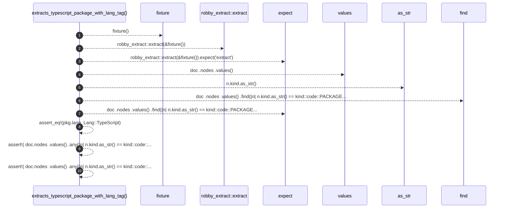

# `robby_extract::test_typescript::extracts_typescript_package_with_lang_tag`

[Self-model](../../README.md) · [test_typescript](index.md)

| | |
|---|---|
| kind | `code.function` |
| signature | `fn extracts_typescript_package_with_lang_tag()` |
| location | [`crates/robby-extract/tests/typescript.rs:12`](../../../../crates/robby-extract/tests/typescript.rs#L12) |
| provenance | extractor · confidence 1.00 |

```rust
#[test]
fn extracts_typescript_package_with_lang_tag() {
    let doc = robby_extract::extract(&fixture()).expect("extract");

    let pkg = doc
        .nodes
        .values()
        .find(|n| n.kind.as_str() == kind::code::PACKAGE && n.name == "ts-mini")
        .expect("package node");
    assert_eq!(pkg.lang, Lang::TypeScript);

    assert!(
        doc.nodes
            .values()
            .any(|n| n.kind.as_str() == kind::code::CLASS && n.name == "Point"),
        "expected Point class"
    );
    assert!(
        doc.nodes
            .values()
            .any(|n| n.kind.as_str() == kind::code::INTERFACE && n.name == "Drawable"),
        "expected Drawable interface"
    );
}
```



10 steps · 0 observed · 10 possible only

**Edges**

- calls → [`robby_extract::test_typescript::fixture`](fixture.md)
- calls → [`robby_extract::extract`](../extract.md)
- calls → [`robby_ir::kind::impl Kind::as_str`](../../robby_ir/kind/index.md)

## References

- calls → [`robby_extract`](../index.md) — extract
- calls → [`robby_extract::test_typescript`](index.md) — fixture
- calls → [`robby_ir::kind`](../../robby_ir/kind/index.md) — as_str

