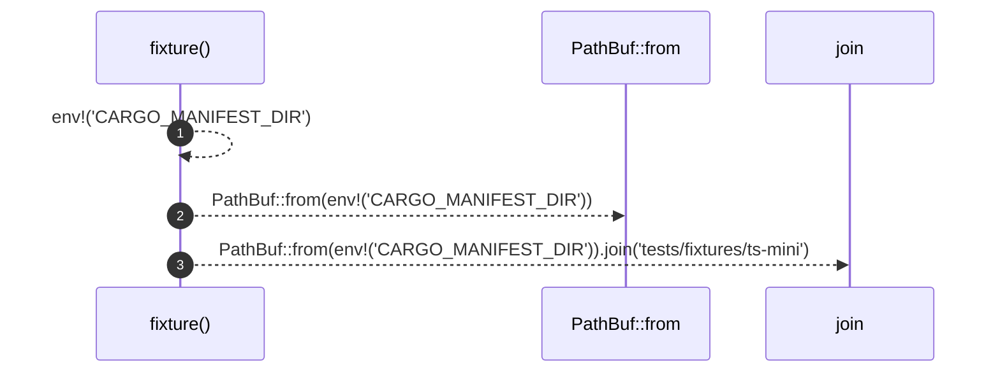

# `robby_extract::test_typescript::fixture`

[Self-model](../../README.md) · [test_typescript](index.md)

| | |
|---|---|
| kind | `code.function` |
| signature | `fn fixture() -> PathBuf` |
| location | [`crates/robby-extract/tests/typescript.rs:8`](../../../../crates/robby-extract/tests/typescript.rs#L8) |
| provenance | extractor · confidence 1.00 |

```rust
fn fixture() -> PathBuf {
    PathBuf::from(env!("CARGO_MANIFEST_DIR")).join("tests/fixtures/ts-mini")
}
```



3 steps · 0 observed · 3 possible only

**Edges**

- calls → [`robby_ir::kind::impl From<&str> for Kind::from`](../../robby_ir/kind/index.md)

## References

- calls → [`robby_ir::kind`](../../robby_ir/kind/index.md) — from

## Referenced by

- calls ← [`robby_extract::test_typescript::bare_import_creates_external_npm_stub`](bare-import-creates-external-npm-stub.md)
- calls ← [`robby_extract::test_typescript::emits_comment_nodes_and_attaches_docs`](emits-comment-nodes-and-attaches-docs.md)
- calls ← [`robby_extract::test_typescript::extracts_typescript_package_with_lang_tag`](extracts-typescript-package-with-lang-tag.md)
- calls ← [`robby_extract::test_typescript::resolves_calls_and_imports`](resolves-calls-and-imports.md)
- calls ← [`robby_extract::test_typescript::typescript_fixture_is_fully_covered`](typescript-fixture-is-fully-covered.md)

