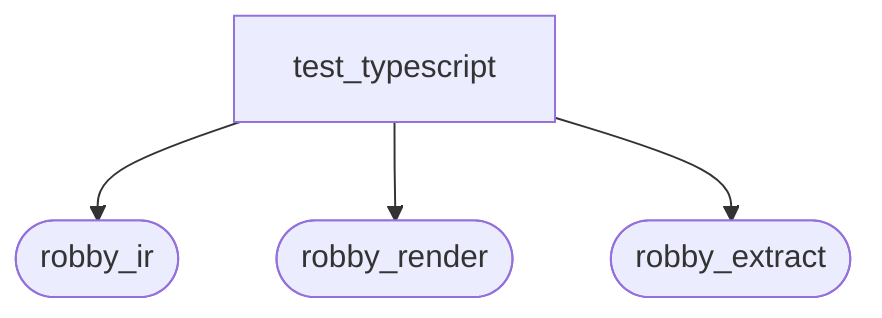
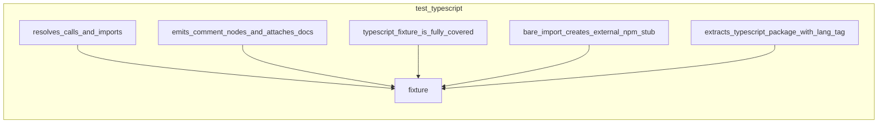

# `robby_extract::test_typescript`

[Self-model](../../README.md) · [robby_extract](../index.md)

| | |
|---|---|
| kind | `code.module` |
| provenance | extractor · confidence 1.00 |
| nodes | 10 |

## Package diagram

## Module coupling

## Dependency matrix

| | test_typescript | robby_ir | robby_render | robby_extract |
|---|---:|---:|---:|---:|
| **test_typescript** | · | 11 | 5 | 6 |
| **robby_ir** | | · | | |
| **robby_render** | | | · | |
| **robby_extract** | | | | · |
## References

- calls → [`robby_extract`](../index.md) — extract
- calls → [`robby_extract::rust`](../rust/index.md) — new
- calls → [`robby_ir::coverage`](../../robby_ir/coverage/index.md) — document_coverage, failures
- calls → [`robby_ir::kind`](../../robby_ir/kind/index.md) — as_str, from
- calls → [`robby_ir::model`](../../robby_ir/model/index.md) — insert
- calls → [`robby_render::view::scene`](../../robby_render/view/scene/index.md) — contains
- calls → [`robby_render::view::select`](../../robby_render/view/select/index.md) — collect

## Items

| Item | Kind | Steps | Location |
|---|---|---:|---|
| [`fixture`](fixture.md) | `code.function` | 3 | `crates/robby-extract/tests/typescript.rs:8:1` |
| [`extracts_typescript_package_with_lang_tag`](extracts-typescript-package-with-lang-tag.md) | `code.function` | 10 | `crates/robby-extract/tests/typescript.rs:12:1` |
| [`resolves_calls_and_imports`](resolves-calls-and-imports.md) | `code.function` | 27 | `crates/robby-extract/tests/typescript.rs:37:1` |
| [`bare_import_creates_external_npm_stub`](bare-import-creates-external-npm-stub.md) | `code.function` | 16 | `crates/robby-extract/tests/typescript.rs:86:1` |
| [`emits_comment_nodes_and_attaches_docs`](emits-comment-nodes-and-attaches-docs.md) | `code.function` | 15 | `crates/robby-extract/tests/typescript.rs:119:1` |
| [`typescript_fixture_is_fully_covered`](typescript-fixture-is-fully-covered.md) | `code.function` | 16 | `crates/robby-extract/tests/typescript.rs:162:1` |

## Imports

- `use std::collections::BTreeMap;`
- `use std::path::PathBuf;`
- [`use robby_ir::{EdgeKind, Lang, kind};`](../../robby_ir/index.md)

