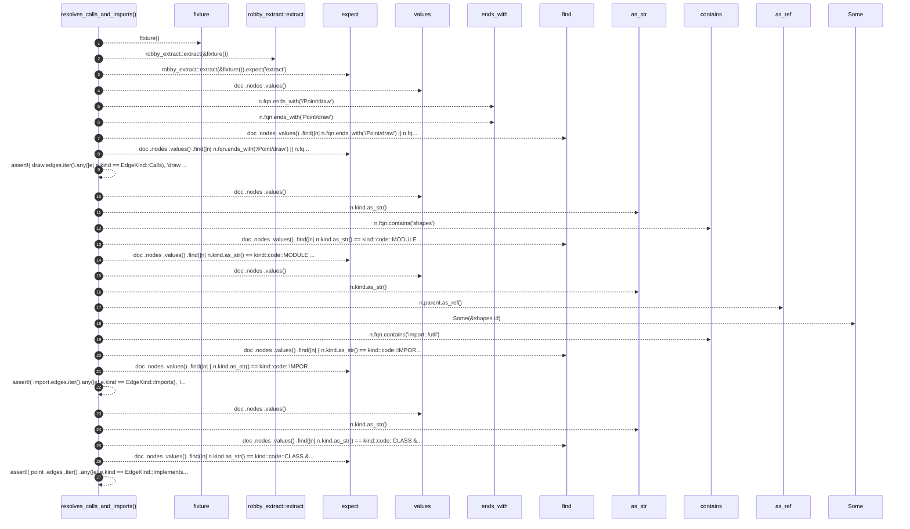

# `robby_extract::test_typescript::resolves_calls_and_imports`

[Self-model](../../README.md) · [test_typescript](index.md)

| | |
|---|---|
| kind | `code.function` |
| signature | `fn resolves_calls_and_imports()` |
| location | [`crates/robby-extract/tests/typescript.rs:37`](../../../../crates/robby-extract/tests/typescript.rs#L37) |
| provenance | extractor · confidence 1.00 |

```rust
#[test]
fn resolves_calls_and_imports() {
    let doc = robby_extract::extract(&fixture()).expect("extract");

    let draw = doc
        .nodes
        .values()
        .find(|n| n.fqn.ends_with("/Point/draw") || n.fqn.ends_with("Point/draw"))
        .expect("Point.draw");
    assert!(
        draw.edges.iter().any(|e| e.kind == EdgeKind::Calls),
        "draw should call helper: {:?}",
        draw.edges
    );

    let shapes = doc
        .nodes
        .values()
        .find(|n| n.kind.as_str() == kind::code::MODULE && n.fqn.contains("shapes"))
        .expect("shapes module");
    let import = doc
        .nodes
        .values()
        .find(|n| {
            n.kind.as_str() == kind::code::IMPORT
                && n.parent.as_ref() == Some(&shapes.id)
                && n.fqn.contains("import:./util")
        })
        .expect("relative import node");
    assert!(
        import.edges.iter().any(|e| e.kind == EdgeKind::Imports),
        "import should resolve: {:?}",
        import.edges
    );

    let point = doc
        .nodes
        .values()
        .find(|n| n.kind.as_str() == kind::code::CLASS && n.name == "Point")
        .expect("Point");
    assert!(
        point
            .edges
            .iter()
            .any(|e| e.kind == EdgeKind::Implements),
        "Point implements Drawable"
    );
}
```



27 steps · 0 observed · 27 possible only

**Edges**

- calls → [`robby_extract::test_typescript::fixture`](fixture.md)
- calls → [`robby_extract::extract`](../extract.md)
- calls → [`robby_ir::kind::impl Kind::as_str`](../../robby_ir/kind/index.md)
- calls → [`robby_render::view::scene::impl WorldRect::contains`](../../robby_render/view/scene/index.md)
- calls → [`robby_ir::kind::impl Kind::as_str`](../../robby_ir/kind/index.md)
- calls → [`robby_render::view::scene::impl WorldRect::contains`](../../robby_render/view/scene/index.md)
- calls → [`robby_ir::kind::impl Kind::as_str`](../../robby_ir/kind/index.md)

## References

- calls → [`robby_extract`](../index.md) — extract
- calls → [`robby_extract::test_typescript`](index.md) — fixture
- calls → [`robby_ir::kind`](../../robby_ir/kind/index.md) — as_str
- calls → [`robby_render::view::scene`](../../robby_render/view/scene/index.md) — contains

