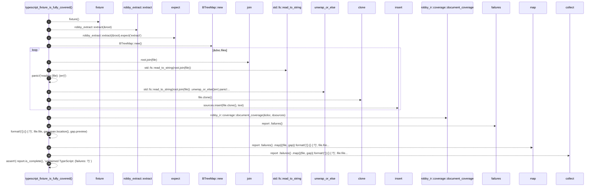

# `robby_extract::test_typescript::typescript_fixture_is_fully_covered`

[Self-model](../../README.md) · [test_typescript](index.md)

| | |
|---|---|
| kind | `code.function` |
| signature | `fn typescript_fixture_is_fully_covered()` |
| location | [`crates/robby-extract/tests/typescript.rs:162`](../../../../crates/robby-extract/tests/typescript.rs#L162) |
| provenance | extractor · confidence 1.00 |

```rust
#[test]
fn typescript_fixture_is_fully_covered() {
    let root = fixture();
    let doc = robby_extract::extract(&root).expect("extract");

    let mut sources = BTreeMap::new();
    for file in &doc.files {
        let text = std::fs::read_to_string(root.join(file))
            .unwrap_or_else(|err| panic!("reading {file}: {err}"));
        sources.insert(file.clone(), text);
    }

    let report = robby_ir::coverage::document_coverage(&doc, &sources);
    let failures: Vec<String> = report
        .failures()
        .map(|(file, gap)| format!("{}:{} {:?}", file.file, gap.span.location(), gap.preview))
        .collect();

    assert!(
        report.is_complete(),
        "unclaimed TypeScript: {failures:#?}"
    );
}
```



16 steps · 0 observed · 16 possible only

**Edges**

- calls → [`robby_extract::test_typescript::fixture`](fixture.md)
- calls → [`robby_extract::extract`](../extract.md)
- calls → [`robby_extract::rust::impl LineIndex::new`](../rust/index.md)
- calls → [`robby_ir::model::impl Document::insert`](../../robby_ir/model/index.md)
- calls → [`robby_ir::coverage::document_coverage`](../../robby_ir/coverage/document-coverage.md)
- calls → [`robby_ir::coverage::impl CoverageReport::failures`](../../robby_ir/coverage/index.md)
- calls → [`robby_render::view::select::collect`](../../robby_render/view/select/collect.md)

## References

- calls → [`robby_extract`](../index.md) — extract
- calls → [`robby_extract::rust`](../rust/index.md) — new
- calls → [`robby_extract::test_typescript`](index.md) — fixture
- calls → [`robby_ir::coverage`](../../robby_ir/coverage/index.md) — document_coverage, failures
- calls → [`robby_ir::model`](../../robby_ir/model/index.md) — insert
- calls → [`robby_render::view::select`](../../robby_render/view/select/index.md) — collect

