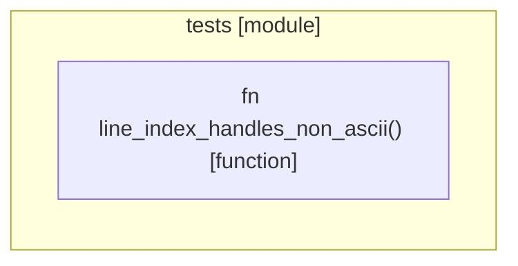

# `robby_extract::tests`

[Self-model](../../README.md) · [robby_extract](../index.md)

| | |
|---|---|
| kind | `code.module` |
| declared at | [`crates/robby-extract/src/lib.rs:839`](../../../../crates/robby-extract/src/lib.rs#L839) |
| provenance | extractor · confidence 1.00 |
| nodes | 3 |

## Items

| Item | Kind | Steps | Location |
|---|---|---:|---|
| [`line_index_handles_non_ascii`](line-index-handles-non-ascii.md) | `code.function` | 6 | `crates/robby-extract/src/lib.rs:843:5` |

## Imports

- `use super::*;`

