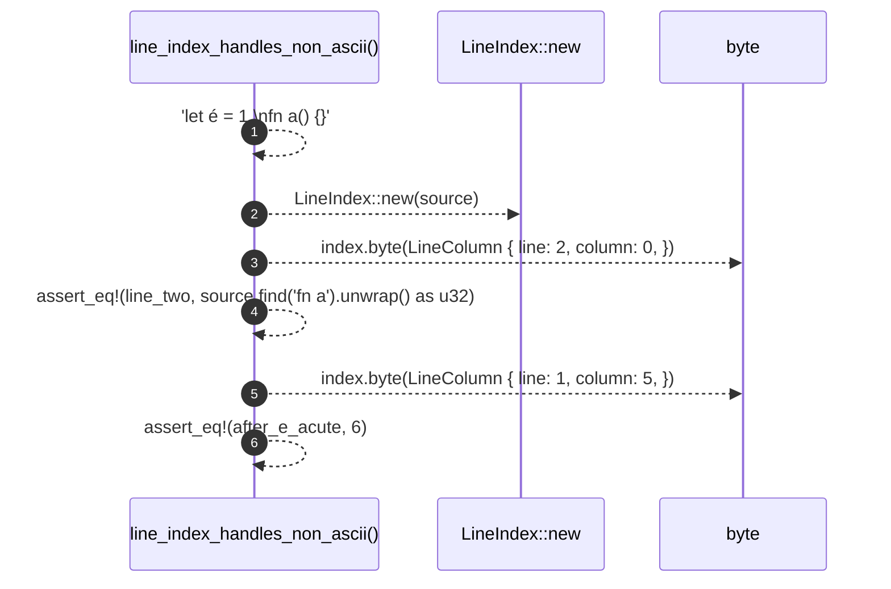

# `robby_extract::line_index_handles_non_ascii`

[Self-model](../../README.md) · [tests](index.md)

| | |
|---|---|
| kind | `code.function` |
| signature | `fn line_index_handles_non_ascii()` |
| location | [`crates/robby-extract/src/lib.rs:843`](../../../../crates/robby-extract/src/lib.rs#L843) |
| provenance | extractor · confidence 1.00 |

```rust
#[test]
    fn line_index_handles_non_ascii() {
        let source = "let é = 1;\nfn a() {}";
        let index = LineIndex::new(source);

        // Start of line 2.
        let line_two = index.byte(LineColumn {
            line: 2,
            column: 0,
        });
        assert_eq!(line_two, source.find("fn a").unwrap() as u32);

        // Column 5 is just past the two-byte `é`, so the byte offset is 6.
        let after_e_acute = index.byte(LineColumn {
            line: 1,
            column: 5,
        });
        assert_eq!(after_e_acute, 6);
    }
```



6 steps · 0 observed · 6 possible only

**Edges**

- calls → [`robby_extract::impl LineIndex::new`](../index.md)
- calls → [`robby_extract::impl LineIndex::byte`](../index.md)
- calls → [`robby_extract::impl LineIndex::byte`](../index.md)

