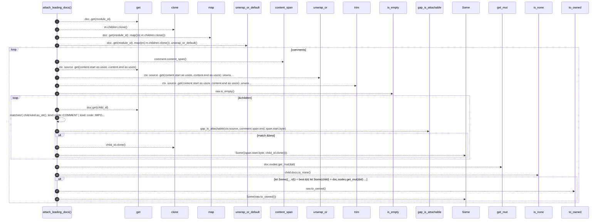

# `robby_extract::typescript::attach_leading_docs`

[Self-model](../../README.md) · [typescript](index.md)

| | |
|---|---|
| kind | `code.function` |
| signature | `fn attach_leading_docs(     doc: &mut Document,     comments: &[Comment],     module_id: &NodeId,     ctx: &Ctx<'_>, )` |
| location | [`crates/robby-extract/src/typescript.rs:421`](../../../../crates/robby-extract/src/typescript.rs#L421) |
| provenance | extractor · confidence 1.00 |

> Attach leading comments (JSDoc-style) onto the following item's `docs`.
> 
> Oxc's `attached_to` is the start of the next *token* (often `export`), while
> our item spans begin at the declaration keyword (`interface` / `class`).
> Prefer an exact span match, else the nearest following item.

```rust
/// Attach leading comments (JSDoc-style) onto the following item's `docs`.
///
/// Oxc's `attached_to` is the start of the next *token* (often `export`), while
/// our item spans begin at the declaration keyword (`interface` / `class`).
/// Prefer an exact span match, else the nearest following item.
fn attach_leading_docs(
    doc: &mut Document,
    comments: &[Comment],
    module_id: &NodeId,
    ctx: &Ctx<'_>,
) {
    let children: Vec<NodeId> = doc
        .get(module_id)
        .map(|m| m.children.clone())
        .unwrap_or_default();

    for comment in comments {
        if comment.position != CommentPosition::Leading {
            continue;
        }
        let content = comment.content_span();
        let raw = ctx
            .source
            .get(content.start as usize..content.end as usize)
            .unwrap_or("")
            .trim();
        if raw.is_empty() {
            continue;
        }

        let anchor = if comment.attached_to != 0 {
            comment.attached_to
        } else {
            comment.span.end
        };

        let mut best: Option<(u32, NodeId)> = None;
        for child_id in &children {
            let Some(child) = doc.get(child_id) else {
                continue;
            };
            if matches!(
                child.kind.as_str(),
                kind::code::COMMENT | kind::code::IMPORT
            ) {
                continue;
            }
            let Some(span) = &child.span else {
                continue;
            };
            if span.start.byte < anchor {
                continue;
            }
            if !gap_is_attachable(ctx.source, comment.span.end, span.start.byte) {
                continue;
            }
            match &best {
                Some((byte, _)) if span.start.byte >= *byte => {}
                _ => best = Some((span.start.byte, child_id.clone())),
            }
        }

        if let Some((_, id)) = best
            && let Some(child) = doc.nodes.get_mut(&id)
            && child.docs.is_none()
        {
            child.docs = Some(raw.to_owned());
        }
    }
}
```



18 steps · 0 observed · 18 possible only

**Edges**

- calls → [`robby_ir::model::impl Document::get`](../../robby_ir/model/index.md)
- calls → [`robby_ir::model::impl Document::get`](../../robby_ir/model/index.md)
- calls → [`robby_ir::span::impl Span::is_empty`](../../robby_ir/span/index.md)
- calls → [`robby_ir::model::impl Document::get`](../../robby_ir/model/index.md)
- calls → [`robby_extract::typescript::gap_is_attachable`](gap-is-attachable.md)

## References

- calls → [`robby_extract::typescript`](index.md) — gap_is_attachable
- calls → [`robby_ir::model`](../../robby_ir/model/index.md) — get
- calls → [`robby_ir::span`](../../robby_ir/span/index.md) — is_empty

## Referenced by

- calls ← [`robby_extract::typescript::extract_file`](extract-file.md)

