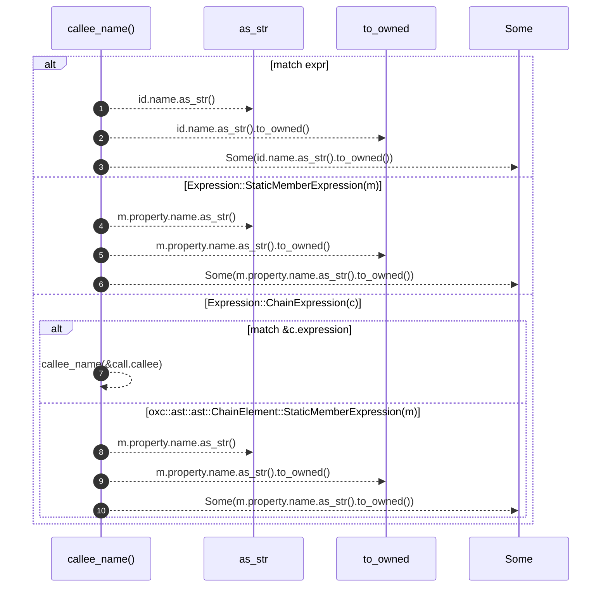

# `robby_extract::typescript::callee_name`

[Self-model](../../README.md) · [typescript](index.md)

| | |
|---|---|
| kind | `code.function` |
| signature | `fn callee_name(expr: &Expression<'_>) -> Option<String>` |
| location | [`crates/robby-extract/src/typescript.rs:964`](../../../../crates/robby-extract/src/typescript.rs#L964) |
| provenance | extractor · confidence 1.00 |

```rust
fn callee_name(expr: &Expression<'_>) -> Option<String> {
    match expr {
        Expression::Identifier(id) => Some(id.name.as_str().to_owned()),
        Expression::StaticMemberExpression(m) => Some(m.property.name.as_str().to_owned()),
        Expression::ChainExpression(c) => match &c.expression {
            oxc::ast::ast::ChainElement::CallExpression(call) => callee_name(&call.callee),
            oxc::ast::ast::ChainElement::StaticMemberExpression(m) => {
                Some(m.property.name.as_str().to_owned())
            }
            _ => None,
        },
        _ => None,
    }
}
```



10 steps · 0 observed · 10 possible only

**Edges**

- calls → [`robby_ir::kind::impl Kind::as_str`](../../robby_ir/kind/index.md)
- calls → [`robby_ir::kind::impl Kind::as_str`](../../robby_ir/kind/index.md)
- calls → [`robby_extract::typescript::callee_name`](callee-name.md)
- calls → [`robby_ir::kind::impl Kind::as_str`](../../robby_ir/kind/index.md)

## References

- calls → [`robby_ir::kind`](../../robby_ir/kind/index.md) — as_str

## Referenced by

- calls ← [`robby_extract::typescript::walk_expr`](walk-expr.md)

