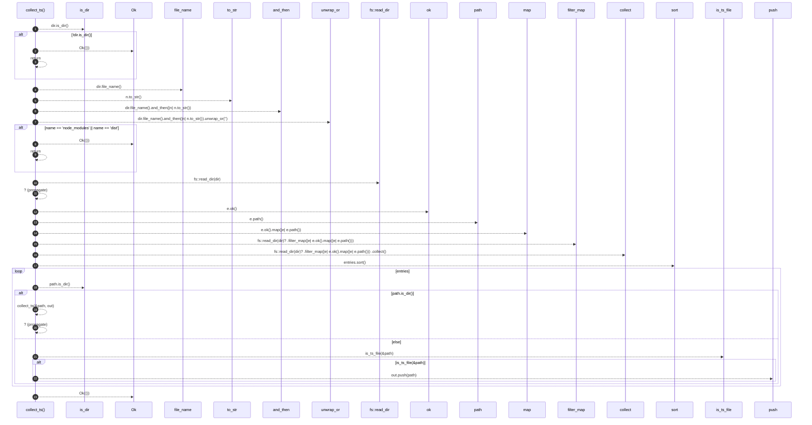

# `robby_extract::typescript::collect_ts`

[Self-model](../../README.md) · [typescript](index.md)

| | |
|---|---|
| kind | `code.function` |
| signature | `fn collect_ts(dir: &Path, out: &mut Vec<PathBuf>) -> Result<()>` |
| location | [`crates/robby-extract/src/typescript.rs:149`](../../../../crates/robby-extract/src/typescript.rs#L149) |
| provenance | extractor · confidence 1.00 |

```rust
fn collect_ts(dir: &Path, out: &mut Vec<PathBuf>) -> Result<()> {
    if !dir.is_dir() {
        return Ok(());
    }
    let name = dir.file_name().and_then(|n| n.to_str()).unwrap_or("");
    if name == "node_modules" || name == "dist" {
        return Ok(());
    }
    let mut entries: Vec<PathBuf> = fs::read_dir(dir)?
        .filter_map(|e| e.ok().map(|e| e.path()))
        .collect();
    entries.sort();
    for path in entries {
        if path.is_dir() {
            collect_ts(&path, out)?;
        } else if is_ts_file(&path) {
            out.push(path);
        }
    }
    Ok(())
}
```



23 steps · 0 observed · 23 possible only

**Edges**

- calls → [`robby_render::view::select::collect`](../../robby_render/view/select/collect.md)
- calls → [`robby_extract::typescript::collect_ts`](collect-ts.md)
- calls → [`robby_extract::typescript::is_ts_file`](is-ts-file.md)
- calls → [`robby_render::report::impl Report::push`](../../robby_render/report/index.md)

## References

- calls → [`robby_extract::typescript`](index.md) — is_ts_file
- calls → [`robby_render::report`](../../robby_render/report/index.md) — push
- calls → [`robby_render::view::select`](../../robby_render/view/select/index.md) — collect

## Referenced by

- calls ← [`robby_extract::typescript::ts_files`](ts-files.md)

