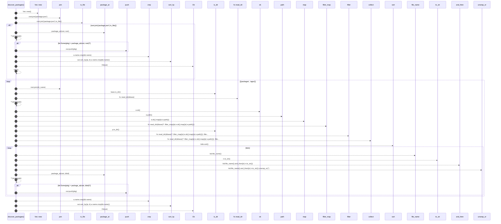

# `robby_extract::typescript::discover_packages`

[Self-model](../../README.md) · [typescript](index.md)

| | |
|---|---|
| kind | `code.function` |
| signature | `fn discover_packages(root: &Path) -> Result<Vec<Package>>` |
| location | [`crates/robby-extract/src/typescript.rs:63`](../../../../crates/robby-extract/src/typescript.rs#L63) |
| provenance | extractor · confidence 1.00 |

```rust
fn discover_packages(root: &Path) -> Result<Vec<Package>> {
    let mut out = Vec::new();

    // Fixture / single-package roots: package.json at the extract root.
    if root.join("package.json").is_file() {
        if let Some(pkg) = package_at(root, root)? {
            out.push(pkg);
        }
        out.sort_by(|a, b| a.name.cmp(&b.name));
        return Ok(out);
    }

    // Workspace layout: only `packages/*` and `apps/*` (skip crates/, fixtures, etc.).
    for dir_name in ["packages", "apps"] {
        let base = root.join(dir_name);
        if !base.is_dir() {
            continue;
        }
        let mut kids: Vec<PathBuf> = fs::read_dir(&base)?
            .filter_map(|e| e.ok().map(|e| e.path()))
            .filter(|p| p.is_dir())
            .collect();
        kids.sort();
        for kid in kids {
            let n = kid.file_name().and_then(|n| n.to_str()).unwrap_or("");
            if n == "node_modules" || n == "dist" {
                continue;
            }
            if let Some(pkg) = package_at(root, &kid)? {
                out.push(pkg);
            }
        }
    }
    out.sort_by(|a, b| a.name.cmp(&b.name));
    Ok(out)
}
```



32 steps · 0 observed · 32 possible only

**Edges**

- calls → [`robby_extract::rust::impl LineIndex::new`](../rust/index.md)
- calls → [`robby_extract::typescript::package_at`](package-at.md)
- calls → [`robby_render::report::impl Report::push`](../../robby_render/report/index.md)
- calls → [`robby_render::view::select::collect`](../../robby_render/view/select/collect.md)
- calls → [`robby_extract::typescript::package_at`](package-at.md)
- calls → [`robby_render::report::impl Report::push`](../../robby_render/report/index.md)

## References

- calls → [`robby_extract::rust`](../rust/index.md) — new
- calls → [`robby_extract::typescript`](index.md) — package_at
- calls → [`robby_render::report`](../../robby_render/report/index.md) — push
- calls → [`robby_render::view::select`](../../robby_render/view/select/index.md) — collect

## Referenced by

- calls ← [`robby_extract::typescript::extract`](extract.md)
- calls ← [`robby_extract::typescript::source_file_count`](source-file-count.md)

