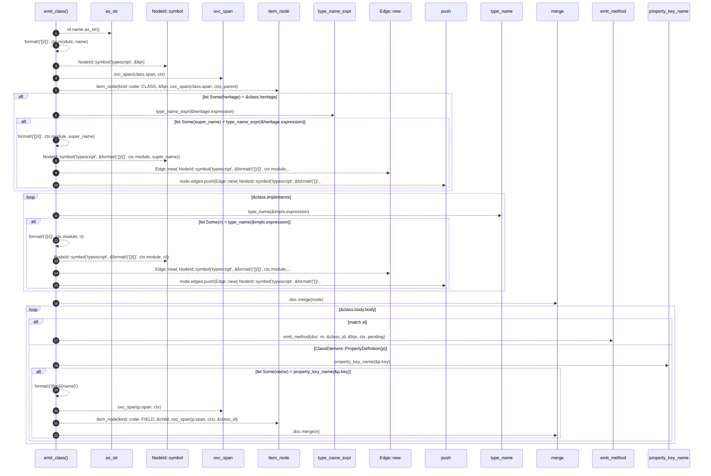

# `robby_extract::typescript::emit_class`

[Self-model](../../README.md) · [typescript](index.md)

| | |
|---|---|
| kind | `code.function` |
| signature | `fn emit_class<'a>(     doc: &mut Document,     class: &Class<'a>,     parent: &NodeId,     ctx: &Ctx<'_>,     pending: &mut Vec<PendingCall>, )` |
| location | [`crates/robby-extract/src/typescript.rs:629`](../../../../crates/robby-extract/src/typescript.rs#L629) |
| provenance | extractor · confidence 1.00 |

```rust
fn emit_class<'a>(
    doc: &mut Document,
    class: &Class<'a>,
    parent: &NodeId,
    ctx: &Ctx<'_>,
    pending: &mut Vec<PendingCall>,
) {
    let Some(id) = &class.id else {
        return;
    };
    let name = id.name.as_str();
    let fqn = format!("{}/{}", ctx.module, name);
    let class_id = NodeId::symbol("typescript", &fqn);
    let mut node = item_node(kind::code::CLASS, &fqn, oxc_span(class.span, ctx), parent);

    if let Some(heritage) = &class.heritage {
        if let Some(super_name) = type_name_expr(&heritage.expression) {
            node.edges.push(Edge::new(
                NodeId::symbol("typescript", &format!("{}/{}", ctx.module, super_name)),
                EdgeKind::Extends,
            ));
        }
    }
    for impls in &class.implements {
        if let Some(n) = type_name(&impls.expression) {
            node.edges.push(Edge::new(
                NodeId::symbol("typescript", &format!("{}/{}", ctx.module, n)),
                EdgeKind::Implements,
            ));
        }
    }
    doc.merge(node);

    for el in &class.body.body {
        match el {
            ClassElement::MethodDefinition(m) => {
                emit_method(doc, m, &class_id, &fqn, ctx, pending);
            }
            ClassElement::PropertyDefinition(p) => {
                if let Some(name) = property_key_name(&p.key) {
                    let child = format!("{fqn}/{name}");
                    let n = item_node(kind::code::FIELD, &child, oxc_span(p.span, ctx), &class_id);
                    doc.merge(n);
                }
            }
            _ => {}
        }
    }
}
```



22 steps · 0 observed · 22 possible only

**Edges**

- calls → [`robby_ir::kind::impl Kind::as_str`](../../robby_ir/kind/index.md)
- calls → [`robby_ir::model::impl NodeId::symbol`](../../robby_ir/model/index.md)
- calls → [`robby_extract::typescript::oxc_span`](oxc-span.md)
- calls → [`robby_extract::typescript::item_node`](item-node.md)
- calls → [`robby_extract::typescript::type_name_expr`](type-name-expr.md)
- calls → [`robby_ir::model::impl NodeId::symbol`](../../robby_ir/model/index.md)
- calls → [`robby_extract::rust::impl LineIndex::new`](../rust/index.md)
- calls → [`robby_render::report::impl Report::push`](../../robby_render/report/index.md)
- calls → [`robby_extract::typescript::type_name`](type-name.md)
- calls → [`robby_ir::model::impl NodeId::symbol`](../../robby_ir/model/index.md)
- calls → [`robby_extract::rust::impl LineIndex::new`](../rust/index.md)
- calls → [`robby_render::report::impl Report::push`](../../robby_render/report/index.md)
- calls → [`robby_ir::model::impl Document::merge`](../../robby_ir/model/index.md)
- calls → [`robby_extract::typescript::emit_method`](emit-method.md)
- calls → [`robby_extract::typescript::property_key_name`](property-key-name.md)
- calls → [`robby_extract::typescript::oxc_span`](oxc-span.md)
- calls → [`robby_extract::typescript::item_node`](item-node.md)
- calls → [`robby_ir::model::impl Document::merge`](../../robby_ir/model/index.md)

## References

- calls → [`robby_extract::rust`](../rust/index.md) — new
- calls → [`robby_extract::typescript`](index.md) — 6 items
- calls → [`robby_ir::kind`](../../robby_ir/kind/index.md) — as_str
- calls → [`robby_ir::model`](../../robby_ir/model/index.md) — merge, symbol
- calls → [`robby_render::report`](../../robby_render/report/index.md) — push

## Referenced by

- calls ← [`robby_extract::typescript::walk_declaration`](walk-declaration.md)
- calls ← [`robby_extract::typescript::walk_statements`](walk-statements.md)

