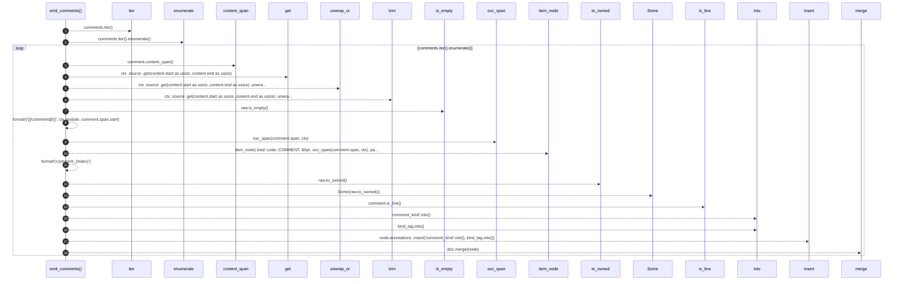

# `robby_extract::typescript::emit_comments`

[Self-model](../../README.md) · [typescript](index.md)

| | |
|---|---|
| kind | `code.function` |
| signature | `fn emit_comments(doc: &mut Document, comments: &[Comment], parent: &NodeId, ctx: &Ctx<'_>)` |
| location | [`crates/robby-extract/src/typescript.rs:394`](../../../../crates/robby-extract/src/typescript.rs#L394) |
| provenance | extractor · confidence 1.00 |

```rust
fn emit_comments(doc: &mut Document, comments: &[Comment], parent: &NodeId, ctx: &Ctx<'_>) {
    for (index, comment) in comments.iter().enumerate() {
        let content = comment.content_span();
        let raw = ctx
            .source
            .get(content.start as usize..content.end as usize)
            .unwrap_or("")
            .trim();
        if raw.is_empty() {
            continue;
        }
        let fqn = format!("{}/comment@{}", ctx.module, comment.span.start);
        let mut node = item_node(
            kind::code::COMMENT,
            &fqn,
            oxc_span(comment.span, ctx),
            parent,
        );
        node.name = format!("comment_{index}");
        node.docs = Some(raw.to_owned());
        let kind_tag = if comment.is_line() { "line" } else { "block" };
        node.annotations
            .insert("comment_kind".into(), kind_tag.into());
        doc.merge(node);
    }
}
```



18 steps · 0 observed · 18 possible only

**Edges**

- calls → [`robby_ir::model::impl Document::get`](../../robby_ir/model/index.md)
- calls → [`robby_ir::span::impl Span::is_empty`](../../robby_ir/span/index.md)
- calls → [`robby_extract::typescript::oxc_span`](oxc-span.md)
- calls → [`robby_extract::typescript::item_node`](item-node.md)
- calls → [`robby_ir::model::impl Document::insert`](../../robby_ir/model/index.md)
- calls → [`robby_ir::model::impl Document::merge`](../../robby_ir/model/index.md)

## References

- calls → [`robby_extract::typescript`](index.md) — item_node, oxc_span
- calls → [`robby_ir::model`](../../robby_ir/model/index.md) — get, insert, merge
- calls → [`robby_ir::span`](../../robby_ir/span/index.md) — is_empty

## Referenced by

- calls ← [`robby_extract::typescript::extract_file`](extract-file.md)

