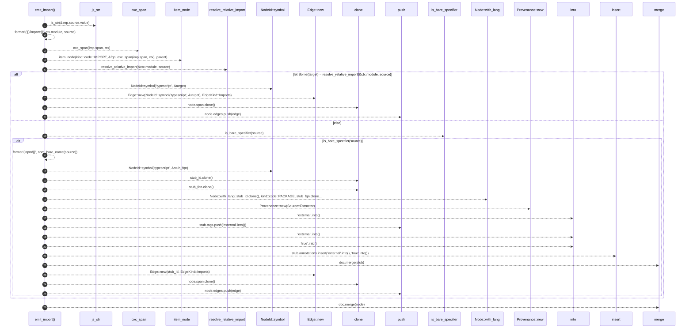

# `robby_extract::typescript::emit_import`

[Self-model](../../README.md) · [typescript](index.md)

| | |
|---|---|
| kind | `code.function` |
| signature | `fn emit_import(     doc: &mut Document,     imp: &ImportDeclaration<'_>,     parent: &NodeId,     ctx: &Ctx<'_>, )` |
| location | [`crates/robby-extract/src/typescript.rs:347`](../../../../crates/robby-extract/src/typescript.rs#L347) |
| provenance | extractor · confidence 1.00 |

```rust
fn emit_import(
    doc: &mut Document,
    imp: &ImportDeclaration<'_>,
    parent: &NodeId,
    ctx: &Ctx<'_>,
) {
    let source = js_str(&imp.source.value);
    let fqn = format!("{}/import:{}", ctx.module, source);
    let mut node = item_node(kind::code::IMPORT, &fqn, oxc_span(imp.span, ctx), parent);
    // Resolve relative imports to a module FQN under the same package prefix.
    if let Some(target) = resolve_relative_import(&ctx.module, source) {
        let mut edge = Edge::new(NodeId::symbol("typescript", &target), EdgeKind::Imports);
        edge.span = node.span.clone();
        node.edges.push(edge);
    } else if is_bare_specifier(source) {
        let stub_fqn = format!("npm/{}", npm_bare_name(source));
        let stub_id = NodeId::symbol("typescript", &stub_fqn);
        let mut stub = Node::with_lang(
            stub_id.clone(),
            kind::code::PACKAGE,
            stub_fqn.clone(),
            Lang::TypeScript,
        );
        stub.provenance = Provenance::new(Source::Extractor);
        stub.tags.push("external".into());
        stub.annotations.insert("external".into(), "true".into());
        doc.merge(stub);
        let mut edge = Edge::new(stub_id, EdgeKind::Imports);
        edge.span = node.span.clone();
        node.edges.push(edge);
    }
    doc.merge(node);
}
```



26 steps · 0 observed · 26 possible only

**Edges**

- calls → [`robby_extract::typescript::js_str`](js-str.md)
- calls → [`robby_extract::typescript::oxc_span`](oxc-span.md)
- calls → [`robby_extract::typescript::item_node`](item-node.md)
- calls → [`robby_extract::typescript::resolve_relative_import`](resolve-relative-import.md)
- calls → [`robby_ir::model::impl NodeId::symbol`](../../robby_ir/model/index.md)
- calls → [`robby_extract::rust::impl LineIndex::new`](../rust/index.md)
- calls → [`robby_render::report::impl Report::push`](../../robby_render/report/index.md)
- calls → [`robby_extract::typescript::is_bare_specifier`](is-bare-specifier.md)
- calls → [`robby_ir::model::impl NodeId::symbol`](../../robby_ir/model/index.md)
- calls → [`robby_ir::model::impl Node::with_lang`](../../robby_ir/model/index.md)
- calls → [`robby_extract::rust::impl LineIndex::new`](../rust/index.md)
- calls → [`robby_render::report::impl Report::push`](../../robby_render/report/index.md)
- calls → [`robby_ir::model::impl Document::insert`](../../robby_ir/model/index.md)
- calls → [`robby_ir::model::impl Document::merge`](../../robby_ir/model/index.md)
- calls → [`robby_extract::rust::impl LineIndex::new`](../rust/index.md)
- calls → [`robby_render::report::impl Report::push`](../../robby_render/report/index.md)
- calls → [`robby_ir::model::impl Document::merge`](../../robby_ir/model/index.md)

## References

- calls → [`robby_extract::rust`](../rust/index.md) — new
- calls → [`robby_extract::typescript`](index.md) — 5 items
- calls → [`robby_ir::model`](../../robby_ir/model/index.md) — insert, merge, symbol, with_lang
- calls → [`robby_render::report`](../../robby_render/report/index.md) — push

## Referenced by

- calls ← [`robby_extract::typescript::walk_statements`](walk-statements.md)

