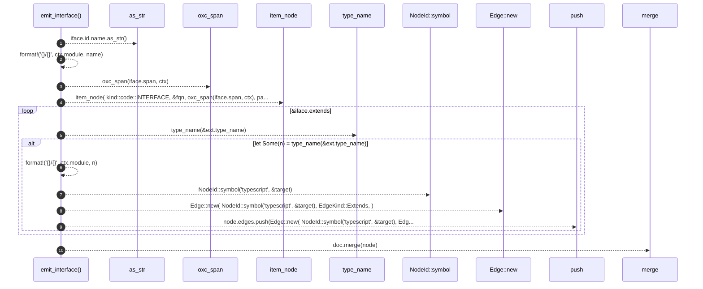

# `robby_extract::typescript::emit_interface`

[Self-model](../../README.md) · [typescript](index.md)

| | |
|---|---|
| kind | `code.function` |
| signature | `fn emit_interface(     doc: &mut Document,     iface: &TSInterfaceDeclaration<'_>,     parent: &NodeId,     ctx: &Ctx<'_>, )` |
| location | [`crates/robby-extract/src/typescript.rs:595`](../../../../crates/robby-extract/src/typescript.rs#L595) |
| provenance | extractor · confidence 1.00 |

```rust
fn emit_interface(
    doc: &mut Document,
    iface: &TSInterfaceDeclaration<'_>,
    parent: &NodeId,
    ctx: &Ctx<'_>,
) {
    let name = iface.id.name.as_str();
    let fqn = format!("{}/{}", ctx.module, name);
    let mut node = item_node(
        kind::code::INTERFACE,
        &fqn,
        oxc_span(iface.span, ctx),
        parent,
    );
    for ext in &iface.extends {
        if let Some(n) = type_name(&ext.type_name) {
            let target = format!("{}/{}", ctx.module, n);
            node.edges.push(Edge::new(
                NodeId::symbol("typescript", &target),
                EdgeKind::Extends,
            ));
        }
    }
    doc.merge(node);
}
```



10 steps · 0 observed · 10 possible only

**Edges**

- calls → [`robby_ir::kind::impl Kind::as_str`](../../robby_ir/kind/index.md)
- calls → [`robby_extract::typescript::oxc_span`](oxc-span.md)
- calls → [`robby_extract::typescript::item_node`](item-node.md)
- calls → [`robby_extract::typescript::type_name`](type-name.md)
- calls → [`robby_ir::model::impl NodeId::symbol`](../../robby_ir/model/index.md)
- calls → [`robby_extract::rust::impl LineIndex::new`](../rust/index.md)
- calls → [`robby_render::report::impl Report::push`](../../robby_render/report/index.md)
- calls → [`robby_ir::model::impl Document::merge`](../../robby_ir/model/index.md)

## References

- calls → [`robby_extract::rust`](../rust/index.md) — new
- calls → [`robby_extract::typescript`](index.md) — item_node, oxc_span, type_name
- calls → [`robby_ir::kind`](../../robby_ir/kind/index.md) — as_str
- calls → [`robby_ir::model`](../../robby_ir/model/index.md) — merge, symbol
- calls → [`robby_render::report`](../../robby_render/report/index.md) — push

## Referenced by

- calls ← [`robby_extract::typescript::walk_declaration`](walk-declaration.md)
- calls ← [`robby_extract::typescript::walk_statements`](walk-statements.md)

