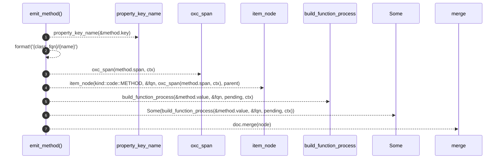

# `robby_extract::typescript::emit_method`

[Self-model](../../README.md) · [typescript](index.md)

| | |
|---|---|
| kind | `code.function` |
| signature | `fn emit_method(     doc: &mut Document,     method: &MethodDefinition<'_>,     parent: &NodeId,     class_fqn: &str,     ctx: &Ctx<'_>,     pending: &mut Vec<PendingCall>, )` |
| location | [`crates/robby-extract/src/typescript.rs:671`](../../../../crates/robby-extract/src/typescript.rs#L671) |
| provenance | extractor · confidence 1.00 |

```rust
fn emit_method(
    doc: &mut Document,
    method: &MethodDefinition<'_>,
    parent: &NodeId,
    class_fqn: &str,
    ctx: &Ctx<'_>,
    pending: &mut Vec<PendingCall>,
) {
    let Some(name) = property_key_name(&method.key) else {
        return;
    };
    let fqn = format!("{class_fqn}/{name}");
    let mut node = item_node(kind::code::METHOD, &fqn, oxc_span(method.span, ctx), parent);
    node.process = Some(build_function_process(&method.value, &fqn, pending, ctx));
    doc.merge(node);
}
```



7 steps · 0 observed · 7 possible only

**Edges**

- calls → [`robby_extract::typescript::property_key_name`](property-key-name.md)
- calls → [`robby_extract::typescript::oxc_span`](oxc-span.md)
- calls → [`robby_extract::typescript::item_node`](item-node.md)
- calls → [`robby_extract::typescript::build_function_process`](build-function-process.md)
- calls → [`robby_ir::model::impl Document::merge`](../../robby_ir/model/index.md)

## References

- calls → [`robby_extract::typescript`](index.md) — build_function_process, item_node, oxc_span, property_key_name
- calls → [`robby_ir::model`](../../robby_ir/model/index.md) — merge

## Referenced by

- calls ← [`robby_extract::typescript::emit_class`](emit-class.md)

