# `robby_extract::typescript::extract_file`

[Self-model](../../README.md) · [typescript](index.md)

| | |
|---|---|
| kind | `code.function` |
| signature | `fn extract_file(     doc: &mut Document,     package: &Package,     file: &Path,     pending: &mut Vec<PendingCall>, ) -> Result<()>` |
| location | [`crates/robby-extract/src/typescript.rs:196`](../../../../crates/robby-extract/src/typescript.rs#L196) |
| provenance | extractor · confidence 1.00 |

```rust
fn extract_file(
    doc: &mut Document,
    package: &Package,
    file: &Path,
    pending: &mut Vec<PendingCall>,
) -> Result<()> {
    let source = fs::read_to_string(file).with_context(|| format!("reading {}", file.display()))?;
    let rel = file
        .strip_prefix(&package.root)
        .unwrap_or(file)
        .to_string_lossy()
        .replace('\\', "/");
    doc.declare_file(rel.clone());

    let allocator = Allocator::default();
    let source_type = SourceType::from_path(file).unwrap_or_else(|_| SourceType::ts());
    let parsed = Parser::new(&allocator, &source, source_type).parse();
    if parsed.fatal_error {
        anyhow::bail!("failed to parse TypeScript file {rel}");
    }

    let fqn = module_fqn(package, file);
    let module_id = NodeId::symbol("typescript", &fqn);
    let mut module = Node::with_lang(
        module_id.clone(),
        kind::code::MODULE,
        fqn.clone(),
        Lang::TypeScript,
    );
    module.provenance = Provenance::new(Source::Extractor);
    if fqn != package.name {
        module.parent = Some(NodeId::symbol("typescript", &package.name));
    }
    // Claim the whole file so trivia (imports between items, etc.) can still
    // fail only on true unknown code; item spans refine the frontier later.
    module.span = Some(Span::new(&rel, &source, 0, source.len() as u32));
    doc.merge(module);

    let ctx = Ctx {
        file: &rel,
        source: &source,
        module: fqn,
    };
    emit_comments(doc, &parsed.program.comments, &module_id, &ctx);
    walk_statements(doc, &parsed.program.body, &module_id, &ctx, pending);
    attach_leading_docs(doc, &parsed.program.comments, &module_id, &ctx);
    Ok(())
}
```

```mermaid
sequenceDiagram
    autonumber
    participant extract_file as extract_file()
    participant fs__read_to_string as fs::read_to_string
    participant with_context as with_context
    participant strip_prefix as strip_prefix
    participant unwrap_or as unwrap_or
    participant to_string_lossy as to_string_lossy
    participant replace as replace
    participant clone as clone
    participant declare_file as declare_file
    participant Allocator__default as Allocator::default
    participant SourceType__from_path as SourceType::from_path
    participant SourceType__ts as SourceType::ts
    participant unwrap_or_else as unwrap_or_else
    participant Parser__new as Parser::new
    participant parse as parse
    participant module_fqn as module_fqn
    participant NodeId__symbol as NodeId::symbol
    participant Node__with_lang as Node::with_lang
    participant Provenance__new as Provenance::new
    participant Some as Some
    participant len as len
    participant Span__new as Span::new
    participant merge as merge
    participant emit_comments as emit_comments
    participant walk_statements as walk_statements
    participant attach_leading_docs as attach_leading_docs
    participant Ok as Ok
    extract_file-->>fs__read_to_string: fs::read_to_string(file)
    extract_file-->>extract_file: format!('reading {}', file.display())
    extract_file-->>with_context: fs::read_to_string(file).with_context(|| format!('reading {}', file.d...
    extract_file-->>extract_file: ? (propagate)
    extract_file-->>strip_prefix: file .strip_prefix(&package.root)
    extract_file-->>unwrap_or: file .strip_prefix(&package.root) .unwrap_or(file)
    extract_file-->>to_string_lossy: file .strip_prefix(&package.root) .unwrap_or(file) .to_string_lossy()
    extract_file-->>replace: file .strip_prefix(&package.root) .unwrap_or(file) .to_string_lossy()...
    extract_file-->>clone: rel.clone()
    extract_file-->>declare_file: doc.declare_file(rel.clone())
    extract_file-->>Allocator__default: Allocator::default()
    extract_file-->>SourceType__from_path: SourceType::from_path(file)
    extract_file-->>SourceType__ts: SourceType::ts()
    extract_file-->>unwrap_or_else: SourceType::from_path(file).unwrap_or_else(|_| SourceType::ts())
    extract_file-->>Parser__new: Parser::new(&allocator, &source, source_type)
    extract_file-->>parse: Parser::new(&allocator, &source, source_type).parse()
    alt parsed.fatal_error
    extract_file-->>extract_file: anyhow::bail!('failed to parse TypeScript file {rel}')
    end
    extract_file-->>module_fqn: module_fqn(package, file)
    extract_file-->>NodeId__symbol: NodeId::symbol('typescript', &fqn)
    extract_file-->>clone: module_id.clone()
    extract_file-->>clone: fqn.clone()
    extract_file-->>Node__with_lang: Node::with_lang( module_id.clone(), kind::code::MODULE, fqn.clone(), ...
    extract_file-->>Provenance__new: Provenance::new(Source::Extractor)
    alt fqn != package.name
    extract_file-->>NodeId__symbol: NodeId::symbol('typescript', &package.name)
    extract_file-->>Some: Some(NodeId::symbol('typescript', &package.name))
    end
    extract_file-->>len: source.len()
    extract_file-->>Span__new: Span::new(&rel, &source, 0, source.len() as u32)
    extract_file-->>Some: Some(Span::new(&rel, &source, 0, source.len() as u32))
    extract_file-->>merge: doc.merge(module)
    extract_file-->>emit_comments: emit_comments(doc, &parsed.program.comments, &module_id, &ctx)
    extract_file-->>walk_statements: walk_statements(doc, &parsed.program.body, &module_id, &ctx, pending)
    extract_file-->>attach_leading_docs: attach_leading_docs(doc, &parsed.program.comments, &module_id, &ctx)
    extract_file-->>Ok: Ok(())
```



33 steps · 0 observed · 33 possible only

**Edges**

- calls → [`robby_ir::model::impl Document::declare_file`](../../robby_ir/model/index.md)
- calls → [`robby_ir::process::impl Default for Process::default`](../../robby_ir/process/index.md)
- calls → [`robby_ir::coverage::impl TriviaMode::from_path`](../../robby_ir/coverage/index.md)
- calls → [`robby_extract::rust::impl LineIndex::new`](../rust/index.md)
- calls → [`robby_ir::vocab::impl Verdict::parse`](../../robby_ir/vocab/index.md)
- calls → [`robby_extract::typescript::module_fqn`](module-fqn.md)
- calls → [`robby_ir::model::impl NodeId::symbol`](../../robby_ir/model/index.md)
- calls → [`robby_ir::model::impl Node::with_lang`](../../robby_ir/model/index.md)
- calls → [`robby_extract::rust::impl LineIndex::new`](../rust/index.md)
- calls → [`robby_ir::model::impl NodeId::symbol`](../../robby_ir/model/index.md)
- calls → [`robby_extract::rust::impl LineIndex::new`](../rust/index.md)
- calls → [`robby_ir::model::impl Document::merge`](../../robby_ir/model/index.md)
- calls → [`robby_extract::typescript::emit_comments`](emit-comments.md)
- calls → [`robby_extract::typescript::walk_statements`](walk-statements.md)
- calls → [`robby_extract::typescript::attach_leading_docs`](attach-leading-docs.md)

## References

- calls → [`robby_extract::rust`](../rust/index.md) — new
- calls → [`robby_extract::typescript`](index.md) — attach_leading_docs, emit_comments, module_fqn, walk_statements
- calls → [`robby_ir::coverage`](../../robby_ir/coverage/index.md) — from_path
- calls → [`robby_ir::model`](../../robby_ir/model/index.md) — declare_file, merge, symbol, with_lang
- calls → [`robby_ir::process`](../../robby_ir/process/index.md) — default
- calls → [`robby_ir::vocab`](../../robby_ir/vocab/index.md) — parse

## Referenced by

- calls ← [`robby_extract::typescript::extract`](extract.md)

