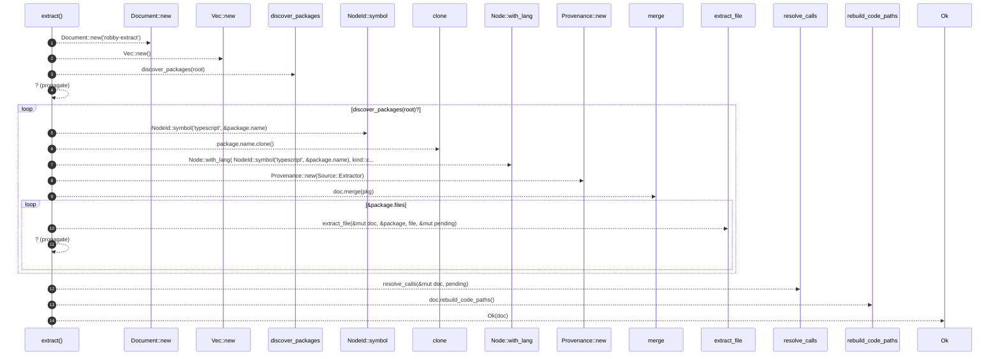

# `robby_extract::typescript::extract`

[Self-model](../../README.md) · [typescript](index.md)

| | |
|---|---|
| kind | `code.function` |
| signature | `fn extract(root: &Path) -> Result<Document>` |
| location | [`crates/robby-extract/src/typescript.rs:23`](../../../../crates/robby-extract/src/typescript.rs#L23) |
| provenance | extractor · confidence 1.00 |

> Extract TypeScript packages under `root`.

```rust
/// Extract TypeScript packages under `root`.
pub(crate) fn extract(root: &Path) -> Result<Document> {
    let mut doc = Document::new("robby-extract");
    let mut pending: Vec<PendingCall> = Vec::new();

    for package in discover_packages(root)? {
        let mut pkg = Node::with_lang(
            NodeId::symbol("typescript", &package.name),
            kind::code::PACKAGE,
            package.name.clone(),
            Lang::TypeScript,
        );
        pkg.provenance = Provenance::new(Source::Extractor);
        doc.merge(pkg);

        for file in &package.files {
            extract_file(&mut doc, &package, file, &mut pending)?;
        }
    }

    resolve_calls(&mut doc, pending);
    doc.rebuild_code_paths();
    Ok(doc)
}
```



14 steps · 0 observed · 14 possible only

**Edges**

- calls → [`robby_extract::rust::impl LineIndex::new`](../rust/index.md)
- calls → [`robby_extract::rust::impl LineIndex::new`](../rust/index.md)
- calls → [`robby_extract::typescript::discover_packages`](discover-packages.md)
- calls → [`robby_ir::model::impl NodeId::symbol`](../../robby_ir/model/index.md)
- calls → [`robby_ir::model::impl Node::with_lang`](../../robby_ir/model/index.md)
- calls → [`robby_extract::rust::impl LineIndex::new`](../rust/index.md)
- calls → [`robby_ir::model::impl Document::merge`](../../robby_ir/model/index.md)
- calls → [`robby_extract::typescript::extract_file`](extract-file.md)
- calls → [`robby_extract::typescript::resolve_calls`](resolve-calls.md)
- calls → [`robby_ir::model::impl Document::rebuild_code_paths`](../../robby_ir/model/index.md)

## References

- calls → [`robby_extract::rust`](../rust/index.md) — new
- calls → [`robby_extract::typescript`](index.md) — discover_packages, extract_file, resolve_calls
- calls → [`robby_ir::model`](../../robby_ir/model/index.md) — merge, rebuild_code_paths, symbol, with_lang

