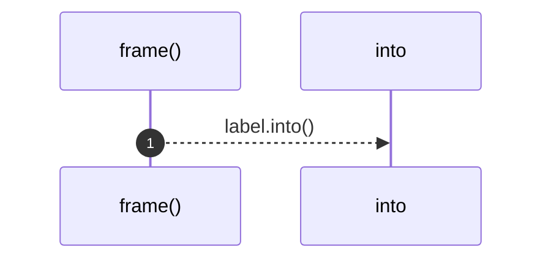

# `robby_extract::typescript::frame`

[Self-model](../../README.md) · [typescript](index.md)

| | |
|---|---|
| kind | `code.function` |
| signature | `fn frame(kind: BlockKind, label: &str) -> Block` |
| location | [`crates/robby-extract/src/typescript.rs:742`](../../../../crates/robby-extract/src/typescript.rs#L742) |
| provenance | extractor · confidence 1.00 |

```rust
fn frame(kind: BlockKind, label: &str) -> Block {
    Block {
        kind,
        label: label.into(),
        branch: None,
    }
}
```



1 steps · 0 observed · 1 possible only

## Referenced by

- calls ← [`robby_extract::typescript::walk_expr`](walk-expr.md)
- calls ← [`robby_extract::typescript::walk_stmts`](walk-stmts.md)

