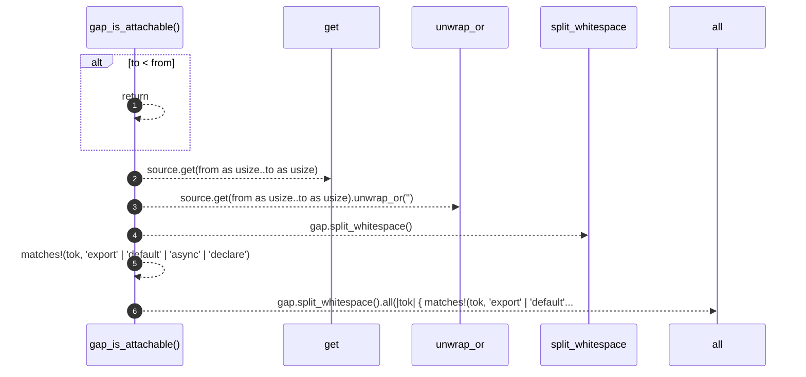

# `robby_extract::typescript::gap_is_attachable`

[Self-model](../../README.md) · [typescript](index.md)

| | |
|---|---|
| kind | `code.function` |
| signature | `fn gap_is_attachable(source: &str, from: u32, to: u32) -> bool` |
| location | [`crates/robby-extract/src/typescript.rs:501`](../../../../crates/robby-extract/src/typescript.rs#L501) |
| provenance | extractor · confidence 1.00 |

> True when the bytes between a comment and an item are only whitespace or
> declaration prefixes (`export` / `default` / `async`).

```rust
/// True when the bytes between a comment and an item are only whitespace or
/// declaration prefixes (`export` / `default` / `async`).
fn gap_is_attachable(source: &str, from: u32, to: u32) -> bool {
    if to < from {
        return false;
    }
    let gap = source.get(from as usize..to as usize).unwrap_or("");
    gap.split_whitespace().all(|tok| {
        matches!(tok, "export" | "default" | "async" | "declare")
    })
}
```



6 steps · 0 observed · 6 possible only

**Edges**

- calls → [`robby_ir::model::impl Document::get`](../../robby_ir/model/index.md)

## References

- calls → [`robby_ir::model`](../../robby_ir/model/index.md) — get

## Referenced by

- calls ← [`robby_extract::typescript::attach_leading_docs`](attach-leading-docs.md)

