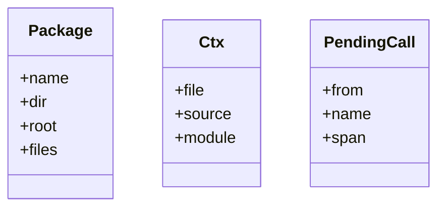
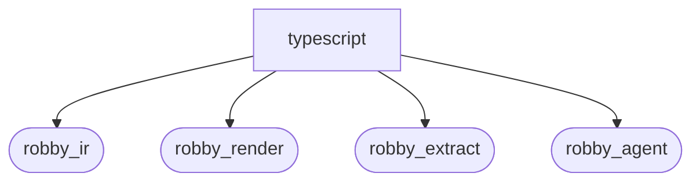

# `robby_extract::typescript`

[Self-model](../../README.md) · [robby_extract](../index.md)

| | |
|---|---|
| kind | `code.module` |
| declared at | [`crates/robby-extract/src/lib.rs:11`](../../../../crates/robby-extract/src/lib.rs#L11) |
| provenance | extractor · confidence 1.00 |
| nodes | 67 |

## Types



## Package diagram



## Module coupling

```mermaid
flowchart TB
    subgraph n_65efc424c4086ad0["typescript"]
        direction TB
        n_f14210b38e26553a["attach_leading_docs"]
        n_13d86de50d18a18b["build_function_process"]
        n_bee5d575e09d876c["callee_name"]
        n_f4803787d8f527f2["collect_ts"]
        n_4cbc254ffa1457b5["discover_packages"]
        n_87c1276a78c09f88["emit_class"]
        n_47feaf4034c26ed2["emit_comments"]
        n_485a3969752a1298["emit_function"]
        n_04598dcdf47019ad["emit_import"]
        n_17996a87532989b3["emit_interface"]
        n_caff78299d2ed171["emit_method"]
        n_feb24023ec942990["emit_variable"]
        n_aad6691009267c88["ensure_participant"]
        n_bf8cfe5cfa98750d["extract"]
        n_0c344646800e99f0["extract_file"]
        n_be06ebcc5fcd4ba9["frame"]
        n_88f246698f7eb41b["gap_is_attachable"]
        n_18d198c74ea04d46["is_bare_specifier"]
        n_7d29750052578457["is_ts_file"]
        n_5ab6cfad2ebb2650["item_node"]
        n_359f9b30d43ad0b3["js_str"]
        n_24ac9120671328b6["module_fqn"]
        n_56241572ad7bd4e9["oxc_span"]
        n_4a57576dbc87afdc["package_at"]
        n_ba75a4c20110a7c5["property_key_name"]
        n_40e148562374c12f["push_step"]
        n_d78d1f9e4f7f4b4f["read_package_name"]
        n_dc68f8404f699d3e["resolve_calls"]
        n_7a24a36ee6ffdb5b["resolve_relative_import"]
        n_1c1c14a8e043f39b["sanitize"]
        n_64025b8cb8f6d298["sanitize_pkg_name"]
        n_8051e23fb2af7ea8["source_file_count"]
        n_76bf9abc00c1141e["strip_ts_ext"]
        n_54826fe250c38efd["ts_files"]
        n_c2b42a76fe622bfa["type_name"]
        n_b04061d398b2e10c["type_name_expr"]
        n_b9edaceaf370369e["walk_declaration"]
        n_49d6d40590eeb5b1["walk_expr"]
        n_701cdf9a411c4304["walk_statements"]
        n_9823549b185de270["walk_stmt"]
        n_e1eac68a67870b19["walk_stmts"]
    end
    n_04598dcdf47019ad --> n_18d198c74ea04d46
    n_04598dcdf47019ad --> n_359f9b30d43ad0b3
    n_04598dcdf47019ad --> n_56241572ad7bd4e9
    n_04598dcdf47019ad --> n_5ab6cfad2ebb2650
    n_04598dcdf47019ad --> n_7a24a36ee6ffdb5b
    n_0c344646800e99f0 --> n_24ac9120671328b6
    n_0c344646800e99f0 --> n_47feaf4034c26ed2
    n_0c344646800e99f0 --> n_701cdf9a411c4304
    n_0c344646800e99f0 --> n_f14210b38e26553a
    n_13d86de50d18a18b --> n_1c1c14a8e043f39b
    n_13d86de50d18a18b --> n_e1eac68a67870b19
    n_17996a87532989b3 --> n_56241572ad7bd4e9
    n_17996a87532989b3 --> n_5ab6cfad2ebb2650
    n_17996a87532989b3 --> n_c2b42a76fe622bfa
    n_24ac9120671328b6 --> n_76bf9abc00c1141e
    n_47feaf4034c26ed2 --> n_56241572ad7bd4e9
    n_47feaf4034c26ed2 --> n_5ab6cfad2ebb2650
    n_485a3969752a1298 --> n_13d86de50d18a18b
    n_485a3969752a1298 --> n_56241572ad7bd4e9
    n_485a3969752a1298 --> n_5ab6cfad2ebb2650
    n_49d6d40590eeb5b1 -->|"2"| n_1c1c14a8e043f39b
    n_49d6d40590eeb5b1 -->|"7"| n_40e148562374c12f
    n_49d6d40590eeb5b1 -->|"2"| n_56241572ad7bd4e9
    n_49d6d40590eeb5b1 -->|"2"| n_aad6691009267c88
    n_49d6d40590eeb5b1 -->|"2"| n_be06ebcc5fcd4ba9
    n_49d6d40590eeb5b1 -->|"2"| n_bee5d575e09d876c
    n_4a57576dbc87afdc --> n_54826fe250c38efd
    n_4a57576dbc87afdc --> n_64025b8cb8f6d298
    n_4a57576dbc87afdc --> n_d78d1f9e4f7f4b4f
    n_4cbc254ffa1457b5 -->|"2"| n_4a57576dbc87afdc
    n_54826fe250c38efd -->|"2"| n_f4803787d8f527f2
    n_701cdf9a411c4304 --> n_04598dcdf47019ad
    n_701cdf9a411c4304 -->|"2"| n_17996a87532989b3
    n_701cdf9a411c4304 -->|"2"| n_485a3969752a1298
    n_701cdf9a411c4304 -->|"2"| n_56241572ad7bd4e9
    n_701cdf9a411c4304 -->|"2"| n_5ab6cfad2ebb2650
    n_701cdf9a411c4304 -->|"2"| n_87c1276a78c09f88
    n_701cdf9a411c4304 --> n_b9edaceaf370369e
    n_701cdf9a411c4304 --> n_feb24023ec942990
    n_7a24a36ee6ffdb5b --> n_76bf9abc00c1141e
    n_8051e23fb2af7ea8 --> n_4cbc254ffa1457b5
    n_87c1276a78c09f88 -->|"2"| n_56241572ad7bd4e9
    n_87c1276a78c09f88 -->|"2"| n_5ab6cfad2ebb2650
    n_87c1276a78c09f88 --> n_b04061d398b2e10c
    n_87c1276a78c09f88 --> n_ba75a4c20110a7c5
    n_87c1276a78c09f88 --> n_c2b42a76fe622bfa
    n_87c1276a78c09f88 --> n_caff78299d2ed171
    n_9823549b185de270 -.->|"1 circular"| n_e1eac68a67870b19
    n_aad6691009267c88 --> n_1c1c14a8e043f39b
    n_b9edaceaf370369e --> n_17996a87532989b3
    n_b9edaceaf370369e --> n_485a3969752a1298
    n_b9edaceaf370369e -->|"2"| n_56241572ad7bd4e9
    n_b9edaceaf370369e -->|"2"| n_5ab6cfad2ebb2650
    n_b9edaceaf370369e --> n_87c1276a78c09f88
    n_b9edaceaf370369e --> n_feb24023ec942990
    n_ba75a4c20110a7c5 --> n_359f9b30d43ad0b3
    n_bf8cfe5cfa98750d --> n_0c344646800e99f0
    n_bf8cfe5cfa98750d --> n_4cbc254ffa1457b5
    n_bf8cfe5cfa98750d --> n_dc68f8404f699d3e
    n_caff78299d2ed171 --> n_13d86de50d18a18b
    n_caff78299d2ed171 --> n_56241572ad7bd4e9
    n_caff78299d2ed171 --> n_5ab6cfad2ebb2650
    n_caff78299d2ed171 --> n_ba75a4c20110a7c5
    n_e1eac68a67870b19 --> n_40e148562374c12f
    n_e1eac68a67870b19 -->|"3"| n_49d6d40590eeb5b1
    n_e1eac68a67870b19 -.->|"7 circular"| n_9823549b185de270
    n_e1eac68a67870b19 -->|"9"| n_be06ebcc5fcd4ba9
    n_f14210b38e26553a --> n_88f246698f7eb41b
    n_f4803787d8f527f2 --> n_7d29750052578457
    n_feb24023ec942990 --> n_13d86de50d18a18b
    n_feb24023ec942990 --> n_1c1c14a8e043f39b
    n_feb24023ec942990 --> n_49d6d40590eeb5b1
    n_feb24023ec942990 -->|"2"| n_56241572ad7bd4e9
    n_feb24023ec942990 -->|"2"| n_5ab6cfad2ebb2650
    n_feb24023ec942990 --> n_e1eac68a67870b19
```



## Dependency matrix

| | typescript | robby_ir | robby_render | robby_extract | robby_agent |
|---|---:|---:|---:|---:|---:|
| **typescript** | · | 76 | 31 | 23 | 1 |
| **robby_ir** | | · | | | |
| **robby_render** | | | · | | |
| **robby_extract** | | | | · | |
| **robby_agent** | | | | | · |

## Comments

- `crates/robby-extract/src/typescript.rs:23:1` (docs, `robby_extract::typescript::extract`): "Extract TypeScript packages under `root`."
  ```
  /// Extract TypeScript packages under `root`.
  pub(crate) fn extract(root: &Path) -> Result<Document> {
      let mut doc = Document::new("robby-extract");
      let mut pending: Vec<PendingCall> = Vec::new();
  
      for package in discover_packages(root)? {
          let mut pkg = Node::with_lang(
              NodeId::symbol("typescript", &package.name),
              kind::code::PACKAGE,
              package.name.clone(),
              Lang::TypeScript,
          );
          pkg.provenance = Provenance::new(Source::Extractor);
          doc.merge(pkg);
  
          for file in &package.files {
              extract_file(&mut doc, &package, file, &mut pending)?;
          }
      }
  
      resolve_calls(&mut doc, pending);
      doc.rebuild_code_paths();
      Ok(doc)
  }
  ```
- `crates/robby-extract/src/typescript.rs:388:1` (docs, `robby_extract::typescript::npm_bare_name`): "`react/jsx-runtime` → `react`; `@scope/pkg/sub` → `@scope/pkg`."
  ```
  /// `react/jsx-runtime` → `react`; `@scope/pkg/sub` → `@scope/pkg`.
  fn npm_bare_name(spec: &str) -> String {
      if let Some(rest) = spec.strip_prefix('@') {
          let mut parts = rest.splitn(3, '/');
          let scope = parts.next().unwrap_or(rest);
          match parts.next() {
              Some(pkg) if !pkg.is_empty() => format!("@{scope}/{pkg}"),
              _ => format!("@{scope}"),
          }
      } else {
          spec.split('/').next().unwrap_or(spec).to_owned()
      }
  }
  ```
- `crates/robby-extract/src/typescript.rs:429:1` (docs, `robby_extract::typescript::attach_leading_docs`): "Attach leading comments (JSDoc-style) onto the following item's `docs`. Oxc's `attached_to` is the start of the next *t…"
  ```
  /// Attach leading comments (JSDoc-style) onto the following item's `docs`.
  ///
  /// Oxc's `attached_to` is the start of the next *token* (often `export`), while
  /// our item spans begin at the declaration keyword (`interface` / `class`).
  /// Prefer an exact span match, else the nearest following item.
  fn attach_leading_docs(
      doc: &mut Document,
      comments: &[Comment],
      module_id: &NodeId,
      ctx: &Ctx<'_>,
  ) {
      let children: Vec<NodeId> = doc
          .get(module_id)
          .map(|m| m.children.clone())
          .unwrap_or_default();
  
      for comment in comments {
          if comment.position != CommentPosition::Leading {
              continue;
          }
          let content = comment.content_span();
          let raw = ctx
              .source
              .get(content.start as usize..content.end as usize)
              .unwrap_or("")
              .trim();
          if raw.is_empty() {
              continue;
          }
  
          let anchor = if comment.attached_to != 0 {
              comment.attached_to
          } else {
              comment.span.end
          };
  
          let mut best: Option<(u32, NodeId)> = None;
          for child_id in &children {
              let Some(child) = doc.get(child_id) else {
                  continue;
              };
              if matches!(
                  child.kind.as_str(),
                  kind::code::COMMENT | kind::code::IMPORT
              ) {
                  continue;
              }
              let Some(span) = &child.span else {
                  continue;
              };
              if span.start.byte < anchor {
                  continue;
              }
              if !gap_is_attachable(ctx.source, comment.span.end, span.start.byte) {
                  continue;
              }
              match &best {
                  Some((byte, _)) if span.start.byte >= *byte => {}
                  _ => best = Some((span.start.byte, child_id.clone())),
              }
          }
  
          if let Some((_, id)) = best {
              if let Some(child) = doc.nodes.get_mut(&id) {
                  if child.docs.is_none() {
                      child.docs = Some(raw.to_owned());
                  }
              }
          }
      }
  }
  ```
- `crates/robby-extract/src/typescript.rs:501:1` (docs, `robby_extract::typescript::gap_is_attachable`): "True when the bytes between a comment and an item are only whitespace or declaration prefixes (`export` / `default` / `…"
  ```
  /// True when the bytes between a comment and an item are only whitespace or
  /// declaration prefixes (`export` / `default` / `async`).
  fn gap_is_attachable(source: &str, from: u32, to: u32) -> bool {
      if to < from {
          return false;
      }
      let gap = source.get(from as usize..to as usize).unwrap_or("");
      gap.split_whitespace().all(|tok| {
          matches!(tok, "export" | "default" | "async" | "declare")
      })
  }
  ```
## References

- calls → [`robby_agent::model`](../../robby_agent/model/index.md) — parse
- calls → [`robby_extract::rust`](../rust/index.md) — new
- calls → [`robby_ir::coverage`](../../robby_ir/coverage/index.md) — from_path
- calls → [`robby_ir::kind`](../../robby_ir/kind/index.md) — as_str, from
- calls → [`robby_ir::model`](../../robby_ir/model/index.md) — 7 items
- calls → [`robby_ir::process`](../../robby_ir/process/index.md) — default, participant
- calls → [`robby_ir::span`](../../robby_ir/span/index.md) — is_empty
- calls → [`robby_render::report`](../../robby_render/report/index.md) — push
- calls → [`robby_render::test_render`](../../robby_render/test_render/index.md) — step
- calls → [`robby_render::view::scene`](../../robby_render/view/scene/index.md) — contains
- calls → [`robby_render::view::select`](../../robby_render/view/select/index.md) — collect

## Items

| Item | Kind | Steps | Location |
|---|---|---:|---|
| [`extract`](extract.md) | `code.function` | 14 | `crates/robby-extract/src/typescript.rs:23:1` |
| [`source_file_count`](source-file-count.md) | `code.function` | 7 | `crates/robby-extract/src/typescript.rs:48:1` |
| [`Package`](package.md) | `code.struct` | — | `crates/robby-extract/src/typescript.rs:55:1` |
| [`discover_packages`](discover-packages.md) | `code.function` | 32 | `crates/robby-extract/src/typescript.rs:63:1` |
| [`package_at`](package-at.md) | `code.function` | 21 | `crates/robby-extract/src/typescript.rs:100:1` |
| [`read_package_name`](read-package-name.md) | `code.function` | 15 | `crates/robby-extract/src/typescript.rs:122:1` |
| [`sanitize_pkg_name`](sanitize-pkg-name.md) | `code.function` | 1 | `crates/robby-extract/src/typescript.rs:132:1` |
| [`ts_files`](ts-files.md) | `code.function` | 9 | `crates/robby-extract/src/typescript.rs:136:1` |
| [`collect_ts`](collect-ts.md) | `code.function` | 23 | `crates/robby-extract/src/typescript.rs:149:1` |
| [`is_ts_file`](is-ts-file.md) | `code.function` | 5 | `crates/robby-extract/src/typescript.rs:171:1` |
| [`module_fqn`](module-fqn.md) | `code.function` | 8 | `crates/robby-extract/src/typescript.rs:177:1` |
| [`strip_ts_ext`](strip-ts-ext.md) | `code.function` | 4 | `crates/robby-extract/src/typescript.rs:190:1` |
| [`extract_file`](extract-file.md) | `code.function` | 33 | `crates/robby-extract/src/typescript.rs:199:1` |
| [`Ctx`](ctx.md) | `code.struct` | — | `crates/robby-extract/src/typescript.rs:248:1` |
| [`PendingCall`](pendingcall.md) | `code.struct` | — | `crates/robby-extract/src/typescript.rs:254:1` |
| [`walk_statements`](walk-statements.md) | `code.function` | 19 | `crates/robby-extract/src/typescript.rs:260:1` |
| [`walk_declaration`](walk-declaration.md) | `code.function` | 14 | `crates/robby-extract/src/typescript.rs:315:1` |
| [`emit_import`](emit-import.md) | `code.function` | 26 | `crates/robby-extract/src/typescript.rs:347:1` |
| [`is_bare_specifier`](is-bare-specifier.md) | `code.function` | 4 | `crates/robby-extract/src/typescript.rs:381:1` |
| [`npm_bare_name`](npm-bare-name.md) | `code.function` | 11 | `crates/robby-extract/src/typescript.rs:388:1` |
| [`emit_comments`](emit-comments.md) | `code.function` | 18 | `crates/robby-extract/src/typescript.rs:402:1` |
| [`attach_leading_docs`](attach-leading-docs.md) | `code.function` | 18 | `crates/robby-extract/src/typescript.rs:429:1` |
| [`gap_is_attachable`](gap-is-attachable.md) | `code.function` | 6 | `crates/robby-extract/src/typescript.rs:501:1` |
| [`resolve_relative_import`](resolve-relative-import.md) | `code.function` | 28 | `crates/robby-extract/src/typescript.rs:513:1` |
| [`emit_variable`](emit-variable.md) | `code.function` | 23 | `crates/robby-extract/src/typescript.rs:542:1` |
| [`emit_function`](emit-function.md) | `code.function` | 7 | `crates/robby-extract/src/typescript.rs:591:1` |
| [`emit_interface`](emit-interface.md) | `code.function` | 10 | `crates/robby-extract/src/typescript.rs:608:1` |
| [`emit_class`](emit-class.md) | `code.function` | 22 | `crates/robby-extract/src/typescript.rs:629:1` |
| [`emit_method`](emit-method.md) | `code.function` | 7 | `crates/robby-extract/src/typescript.rs:679:1` |
| [`property_key_name`](property-key-name.md) | `code.function` | 9 | `crates/robby-extract/src/typescript.rs:701:1` |
| [`type_name_expr`](type-name-expr.md) | `code.function` | 7 | `crates/robby-extract/src/typescript.rs:710:1` |
| [`type_name`](type-name.md) | `code.function` | 9 | `crates/robby-extract/src/typescript.rs:721:1` |
| [`build_function_process`](build-function-process.md) | `code.function` | 14 | `crates/robby-extract/src/typescript.rs:732:1` |
| [`frame`](frame.md) | `code.function` | 1 | `crates/robby-extract/src/typescript.rs:756:1` |
| [`walk_stmts`](walk-stmts.md) | `code.function` | 43 | `crates/robby-extract/src/typescript.rs:764:1` |
| [`walk_stmt`](walk-stmt.md) | `code.function` | 2 | `crates/robby-extract/src/typescript.rs:858:1` |
| [`walk_expr`](walk-expr.md) | `code.function` | 48 | `crates/robby-extract/src/typescript.rs:869:1` |
| [`callee_name`](callee-name.md) | `code.function` | 10 | `crates/robby-extract/src/typescript.rs:964:1` |
| [`push_step`](push-step.md) | `code.function` | 5 | `crates/robby-extract/src/typescript.rs:979:1` |
| [`ensure_participant`](ensure-participant.md) | `code.function` | 4 | `crates/robby-extract/src/typescript.rs:991:1` |
| [`js_str`](js-str.md) | `code.function` | 2 | `crates/robby-extract/src/typescript.rs:999:1` |
| [`item_node`](item-node.md) | `code.function` | 6 | `crates/robby-extract/src/typescript.rs:1003:1` |
| [`oxc_span`](oxc-span.md) | `code.function` | 1 | `crates/robby-extract/src/typescript.rs:1016:1` |
| [`sanitize`](sanitize.md) | `code.function` | 13 | `crates/robby-extract/src/typescript.rs:1020:1` |
| [`resolve_calls`](resolve-calls.md) | `code.function` | 16 | `crates/robby-extract/src/typescript.rs:1038:1` |

## Imports

- `use std::collections::BTreeMap;`
- `use std::fs;`
- `use std::path::{Path, PathBuf};`
- `use anyhow::{Context, Result};`
- `use oxc::allocator::Allocator;`
- `use oxc::ast::ast::{`
- `use oxc::ast::{Comment, CommentPosition};`
- `use oxc::parser::Parser;`
- `use oxc::span::{SourceType, Span as OxcSpan};`
- [`use robby_ir::{`](../../robby_ir/index.md)
- `use serde_json::Value;`

