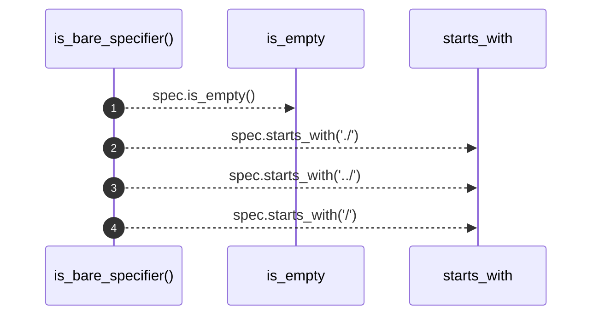

# `robby_extract::typescript::is_bare_specifier`

[Self-model](../../README.md) · [typescript](index.md)

| | |
|---|---|
| kind | `code.function` |
| signature | `fn is_bare_specifier(spec: &str) -> bool` |
| location | [`crates/robby-extract/src/typescript.rs:381`](../../../../crates/robby-extract/src/typescript.rs#L381) |
| provenance | extractor · confidence 1.00 |

```rust
fn is_bare_specifier(spec: &str) -> bool {
    !spec.is_empty()
        && !spec.starts_with("./")
        && !spec.starts_with("../")
        && !spec.starts_with('/')
}
```



4 steps · 0 observed · 4 possible only

**Edges**

- calls → [`robby_ir::span::impl Span::is_empty`](../../robby_ir/span/index.md)

## References

- calls → [`robby_ir::span`](../../robby_ir/span/index.md) — is_empty

## Referenced by

- calls ← [`robby_extract::typescript::emit_import`](emit-import.md)

