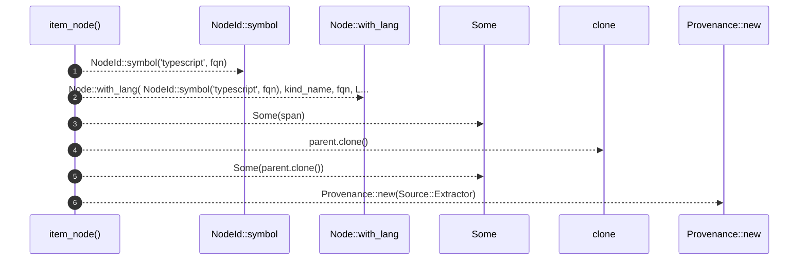

# `robby_extract::typescript::item_node`

[Self-model](../../README.md) · [typescript](index.md)

| | |
|---|---|
| kind | `code.function` |
| signature | `fn item_node(kind_name: &str, fqn: &str, span: Span, parent: &NodeId) -> Node` |
| location | [`crates/robby-extract/src/typescript.rs:996`](../../../../crates/robby-extract/src/typescript.rs#L996) |
| provenance | extractor · confidence 1.00 |

```rust
fn item_node(kind_name: &str, fqn: &str, span: Span, parent: &NodeId) -> Node {
    let mut node = Node::with_lang(
        NodeId::symbol("typescript", fqn),
        kind_name,
        fqn,
        Lang::TypeScript,
    );
    node.span = Some(span);
    node.parent = Some(parent.clone());
    node.provenance = Provenance::new(Source::Extractor);
    node
}
```



6 steps · 0 observed · 6 possible only

**Edges**

- calls → [`robby_ir::model::impl NodeId::symbol`](../../robby_ir/model/index.md)
- calls → [`robby_ir::model::impl Node::with_lang`](../../robby_ir/model/index.md)
- calls → [`robby_extract::rust::impl LineIndex::new`](../rust/index.md)

## References

- calls → [`robby_extract::rust`](../rust/index.md) — new
- calls → [`robby_ir::model`](../../robby_ir/model/index.md) — symbol, with_lang

## Referenced by

- calls ← [`robby_extract::typescript::emit_class`](emit-class.md)
- calls ← [`robby_extract::typescript::emit_comments`](emit-comments.md)
- calls ← [`robby_extract::typescript::emit_function`](emit-function.md)
- calls ← [`robby_extract::typescript::emit_import`](emit-import.md)
- calls ← [`robby_extract::typescript::emit_interface`](emit-interface.md)
- calls ← [`robby_extract::typescript::emit_method`](emit-method.md)
- calls ← [`robby_extract::typescript::emit_variable`](emit-variable.md)
- calls ← [`robby_extract::typescript::walk_declaration`](walk-declaration.md)
- calls ← [`robby_extract::typescript::walk_statements`](walk-statements.md)

