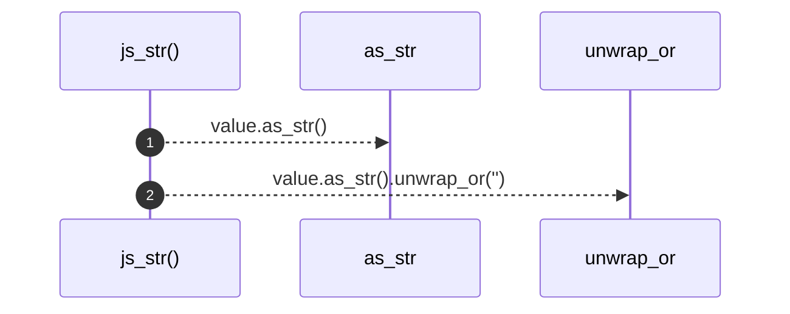

# `robby_extract::typescript::js_str`

[Self-model](../../README.md) · [typescript](index.md)

| | |
|---|---|
| kind | `code.function` |
| signature | `fn js_str<'a>(value: &oxc::str::JSStr<'a>) -> &'a str` |
| location | [`crates/robby-extract/src/typescript.rs:999`](../../../../crates/robby-extract/src/typescript.rs#L999) |
| provenance | extractor · confidence 1.00 |

```rust
fn js_str<'a>(value: &oxc::str::JSStr<'a>) -> &'a str {
    value.as_str().unwrap_or("")
}
```



2 steps · 0 observed · 2 possible only

**Edges**

- calls → [`robby_ir::kind::impl Kind::as_str`](../../robby_ir/kind/index.md)

## References

- calls → [`robby_ir::kind`](../../robby_ir/kind/index.md) — as_str

## Referenced by

- calls ← [`robby_extract::typescript::emit_import`](emit-import.md)
- calls ← [`robby_extract::typescript::property_key_name`](property-key-name.md)

