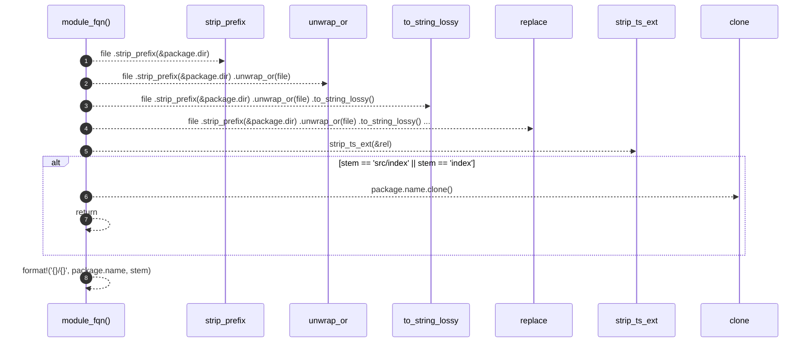

# `robby_extract::typescript::module_fqn`

[Self-model](../../README.md) · [typescript](index.md)

| | |
|---|---|
| kind | `code.function` |
| signature | `fn module_fqn(package: &Package, file: &Path) -> String` |
| location | [`crates/robby-extract/src/typescript.rs:174`](../../../../crates/robby-extract/src/typescript.rs#L174) |
| provenance | extractor · confidence 1.00 |

```rust
fn module_fqn(package: &Package, file: &Path) -> String {
    let rel = file
        .strip_prefix(&package.dir)
        .unwrap_or(file)
        .to_string_lossy()
        .replace('\\', "/");
    let stem = strip_ts_ext(&rel);
    if stem == "src/index" || stem == "index" {
        return package.name.clone();
    }
    format!("{}/{}", package.name, stem)
}
```



8 steps · 0 observed · 8 possible only

**Edges**

- calls → [`robby_extract::typescript::strip_ts_ext`](strip-ts-ext.md)

## References

- calls → [`robby_extract::typescript`](index.md) — strip_ts_ext

## Referenced by

- calls ← [`robby_extract::typescript::extract_file`](extract-file.md)

