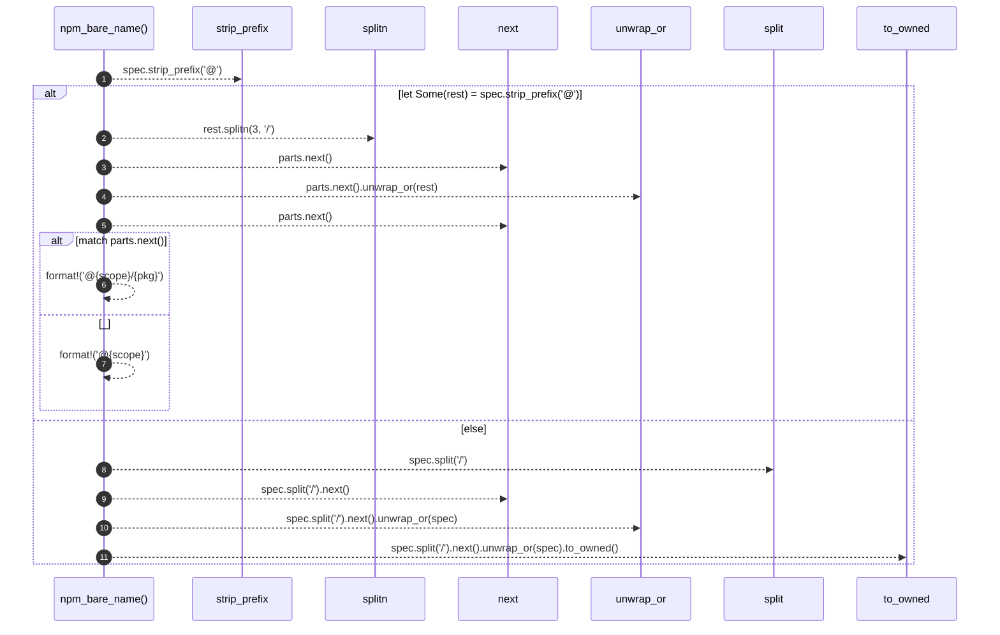

# `robby_extract::typescript::npm_bare_name`

[Self-model](../../README.md) · [typescript](index.md)

| | |
|---|---|
| kind | `code.function` |
| signature | `fn npm_bare_name(spec: &str) -> String` |
| location | [`crates/robby-extract/src/typescript.rs:388`](../../../../crates/robby-extract/src/typescript.rs#L388) |
| provenance | extractor · confidence 1.00 |

> `react/jsx-runtime` → `react`; `@scope/pkg/sub` → `@scope/pkg`.

```rust
/// `react/jsx-runtime` → `react`; `@scope/pkg/sub` → `@scope/pkg`.
fn npm_bare_name(spec: &str) -> String {
    if let Some(rest) = spec.strip_prefix('@') {
        let mut parts = rest.splitn(3, '/');
        let scope = parts.next().unwrap_or(rest);
        match parts.next() {
            Some(pkg) if !pkg.is_empty() => format!("@{scope}/{pkg}"),
            _ => format!("@{scope}"),
        }
    } else {
        spec.split('/').next().unwrap_or(spec).to_owned()
    }
}
```



11 steps · 0 observed · 11 possible only

