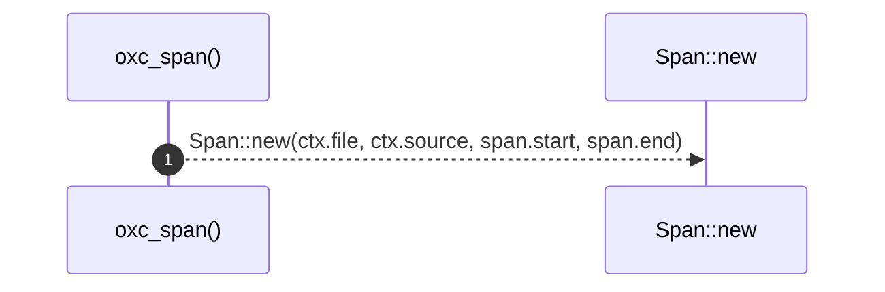

# `robby_extract::typescript::oxc_span`

[Self-model](../../README.md) · [typescript](index.md)

| | |
|---|---|
| kind | `code.function` |
| signature | `fn oxc_span(span: OxcSpan, ctx: &Ctx<'_>) -> Span` |
| location | [`crates/robby-extract/src/typescript.rs:1016`](../../../../crates/robby-extract/src/typescript.rs#L1016) |
| provenance | extractor · confidence 1.00 |

```rust
fn oxc_span(span: OxcSpan, ctx: &Ctx<'_>) -> Span {
    Span::new(ctx.file, ctx.source, span.start, span.end)
}
```



1 steps · 0 observed · 1 possible only

**Edges**

- calls → [`robby_extract::rust::impl LineIndex::new`](../rust/index.md)

## References

- calls → [`robby_extract::rust`](../rust/index.md) — new

## Referenced by

- calls ← [`robby_extract::typescript::emit_class`](emit-class.md)
- calls ← [`robby_extract::typescript::emit_comments`](emit-comments.md)
- calls ← [`robby_extract::typescript::emit_function`](emit-function.md)
- calls ← [`robby_extract::typescript::emit_import`](emit-import.md)
- calls ← [`robby_extract::typescript::emit_interface`](emit-interface.md)
- calls ← [`robby_extract::typescript::emit_method`](emit-method.md)
- calls ← [`robby_extract::typescript::emit_variable`](emit-variable.md)
- calls ← [`robby_extract::typescript::walk_declaration`](walk-declaration.md)
- calls ← [`robby_extract::typescript::walk_expr`](walk-expr.md)
- calls ← [`robby_extract::typescript::walk_statements`](walk-statements.md)

