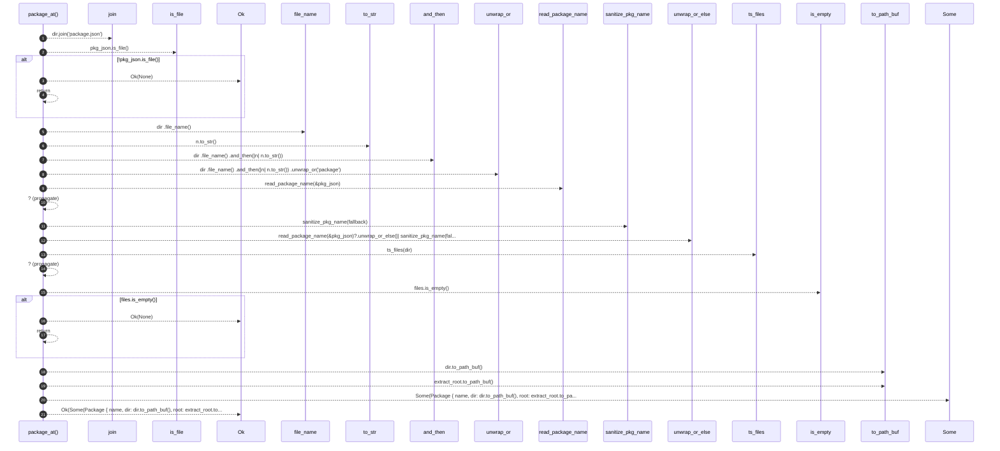

# `robby_extract::typescript::package_at`

[Self-model](../../README.md) · [typescript](index.md)

| | |
|---|---|
| kind | `code.function` |
| signature | `fn package_at(extract_root: &Path, dir: &Path) -> Result<Option<Package>>` |
| location | [`crates/robby-extract/src/typescript.rs:100`](../../../../crates/robby-extract/src/typescript.rs#L100) |
| provenance | extractor · confidence 1.00 |

```rust
fn package_at(extract_root: &Path, dir: &Path) -> Result<Option<Package>> {
    let pkg_json = dir.join("package.json");
    if !pkg_json.is_file() {
        return Ok(None);
    }
    let fallback = dir
        .file_name()
        .and_then(|n| n.to_str())
        .unwrap_or("package");
    let name = read_package_name(&pkg_json)?.unwrap_or_else(|| sanitize_pkg_name(fallback));
    let files = ts_files(dir)?;
    if files.is_empty() {
        return Ok(None);
    }
    Ok(Some(Package {
        name,
        dir: dir.to_path_buf(),
        root: extract_root.to_path_buf(),
        files,
    }))
}
```



21 steps · 0 observed · 21 possible only

**Edges**

- calls → [`robby_extract::typescript::read_package_name`](read-package-name.md)
- calls → [`robby_extract::typescript::sanitize_pkg_name`](sanitize-pkg-name.md)
- calls → [`robby_extract::typescript::ts_files`](ts-files.md)
- calls → [`robby_ir::span::impl Span::is_empty`](../../robby_ir/span/index.md)

## References

- calls → [`robby_extract::typescript`](index.md) — read_package_name, sanitize_pkg_name, ts_files
- calls → [`robby_ir::span`](../../robby_ir/span/index.md) — is_empty

## Referenced by

- calls ← [`robby_extract::typescript::discover_packages`](discover-packages.md)

