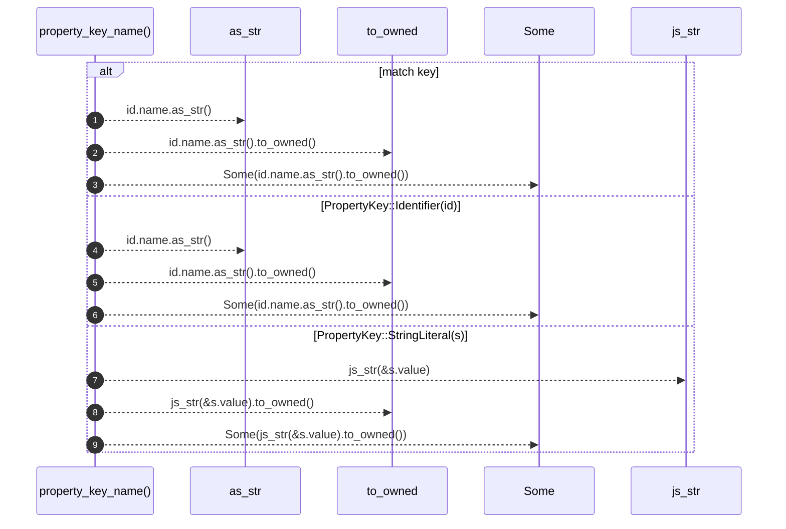

# `robby_extract::typescript::property_key_name`

[Self-model](../../README.md) · [typescript](index.md)

| | |
|---|---|
| kind | `code.function` |
| signature | `fn property_key_name(key: &PropertyKey<'_>) -> Option<String>` |
| location | [`crates/robby-extract/src/typescript.rs:701`](../../../../crates/robby-extract/src/typescript.rs#L701) |
| provenance | extractor · confidence 1.00 |

```rust
fn property_key_name(key: &PropertyKey<'_>) -> Option<String> {
    match key {
        PropertyKey::StaticIdentifier(id) => Some(id.name.as_str().to_owned()),
        PropertyKey::Identifier(id) => Some(id.name.as_str().to_owned()),
        PropertyKey::StringLiteral(s) => Some(js_str(&s.value).to_owned()),
        _ => None,
    }
}
```



9 steps · 0 observed · 9 possible only

**Edges**

- calls → [`robby_ir::kind::impl Kind::as_str`](../../robby_ir/kind/index.md)
- calls → [`robby_ir::kind::impl Kind::as_str`](../../robby_ir/kind/index.md)
- calls → [`robby_extract::typescript::js_str`](js-str.md)

## References

- calls → [`robby_extract::typescript`](index.md) — js_str
- calls → [`robby_ir::kind`](../../robby_ir/kind/index.md) — as_str

## Referenced by

- calls ← [`robby_extract::typescript::emit_class`](emit-class.md)
- calls ← [`robby_extract::typescript::emit_method`](emit-method.md)

