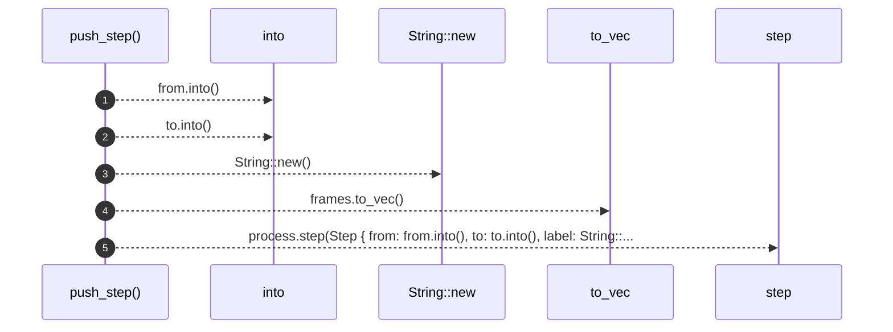

# `robby_extract::typescript::push_step`

[Self-model](../../README.md) · [typescript](index.md)

| | |
|---|---|
| kind | `code.function` |
| signature | `fn push_step(process: &mut Process, frames: &[Block], kind: StepKind, from: &str, to: &str)` |
| location | [`crates/robby-extract/src/typescript.rs:979`](../../../../crates/robby-extract/src/typescript.rs#L979) |
| provenance | extractor · confidence 1.00 |

```rust
fn push_step(process: &mut Process, frames: &[Block], kind: StepKind, from: &str, to: &str) {
    process.step(Step {
        from: from.into(),
        to: to.into(),
        label: String::new(),
        kind,
        observed: false,
        span: None,
        blocks: frames.to_vec(),
    });
}
```



5 steps · 0 observed · 5 possible only

**Edges**

- calls → [`robby_extract::rust::impl LineIndex::new`](../rust/index.md)
- calls → [`robby_render::test_render::step`](../../robby_render/test_render/step.md)

## References

- calls → [`robby_extract::rust`](../rust/index.md) — new
- calls → [`robby_render::test_render`](../../robby_render/test_render/index.md) — step

## Referenced by

- calls ← [`robby_extract::typescript::walk_expr`](walk-expr.md)
- calls ← [`robby_extract::typescript::walk_stmts`](walk-stmts.md)

