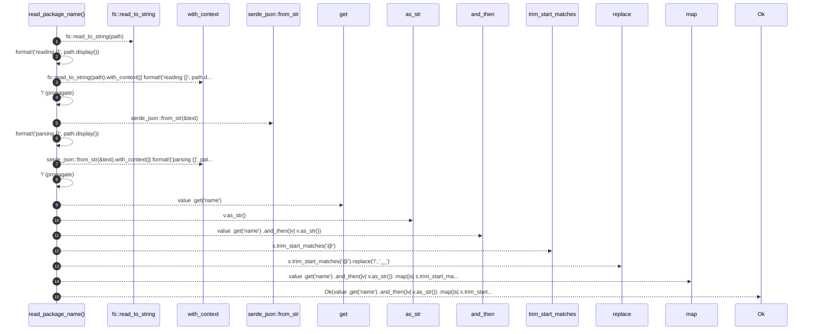

# `robby_extract::typescript::read_package_name`

[Self-model](../../README.md) · [typescript](index.md)

| | |
|---|---|
| kind | `code.function` |
| signature | `fn read_package_name(path: &Path) -> Result<Option<String>>` |
| location | [`crates/robby-extract/src/typescript.rs:119`](../../../../crates/robby-extract/src/typescript.rs#L119) |
| provenance | extractor · confidence 1.00 |

```rust
fn read_package_name(path: &Path) -> Result<Option<String>> {
    let text = fs::read_to_string(path).with_context(|| format!("reading {}", path.display()))?;
    let value: Value =
        serde_json::from_str(&text).with_context(|| format!("parsing {}", path.display()))?;
    Ok(value
        .get("name")
        .and_then(|v| v.as_str())
        .map(|s| s.trim_start_matches('@').replace('/', "__")))
}
```



15 steps · 0 observed · 15 possible only

**Edges**

- calls → [`robby_ir::model::impl Document::get`](../../robby_ir/model/index.md)
- calls → [`robby_ir::kind::impl Kind::as_str`](../../robby_ir/kind/index.md)

## References

- calls → [`robby_ir::kind`](../../robby_ir/kind/index.md) — as_str
- calls → [`robby_ir::model`](../../robby_ir/model/index.md) — get

## Referenced by

- calls ← [`robby_extract::typescript::package_at`](package-at.md)

