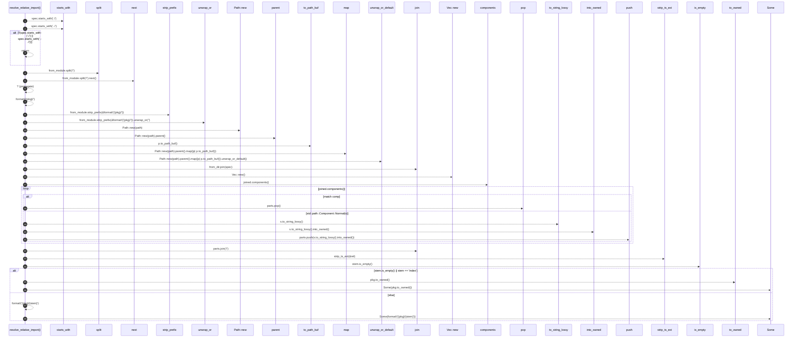

# `robby_extract::typescript::resolve_relative_import`

[Self-model](../../README.md) · [typescript](index.md)

| | |
|---|---|
| kind | `code.function` |
| signature | `fn resolve_relative_import(from_module: &str, spec: &str) -> Option<String>` |
| location | [`crates/robby-extract/src/typescript.rs:513`](../../../../crates/robby-extract/src/typescript.rs#L513) |
| provenance | extractor · confidence 1.00 |

```rust
fn resolve_relative_import(from_module: &str, spec: &str) -> Option<String> {
    if !(spec.starts_with("./") || spec.starts_with("../")) {
        return None;
    }
    let pkg = from_module.split('/').next()?;
    let from_dir = {
        let path = from_module.strip_prefix(&format!("{pkg}/")).unwrap_or("");
        Path::new(path).parent().map(|p| p.to_path_buf()).unwrap_or_default()
    };
    let joined = from_dir.join(spec);
    let mut parts = Vec::new();
    for comp in joined.components() {
        match comp {
            std::path::Component::ParentDir => {
                parts.pop();
            }
            std::path::Component::Normal(s) => parts.push(s.to_string_lossy().into_owned()),
            _ => {}
        }
    }
    let rel = parts.join("/");
    let stem = strip_ts_ext(&rel);
    if stem.is_empty() || stem == "index" {
        Some(pkg.to_owned())
    } else {
        Some(format!("{pkg}/{stem}"))
    }
}
```



28 steps · 0 observed · 28 possible only

**Edges**

- calls → [`robby_extract::rust::impl LineIndex::new`](../rust/index.md)
- calls → [`robby_extract::rust::impl LineIndex::new`](../rust/index.md)
- calls → [`robby_render::report::impl Report::push`](../../robby_render/report/index.md)
- calls → [`robby_extract::typescript::strip_ts_ext`](strip-ts-ext.md)
- calls → [`robby_ir::span::impl Span::is_empty`](../../robby_ir/span/index.md)

## References

- calls → [`robby_extract::rust`](../rust/index.md) — new
- calls → [`robby_extract::typescript`](index.md) — strip_ts_ext
- calls → [`robby_ir::span`](../../robby_ir/span/index.md) — is_empty
- calls → [`robby_render::report`](../../robby_render/report/index.md) — push

## Referenced by

- calls ← [`robby_extract::typescript::emit_import`](emit-import.md)

