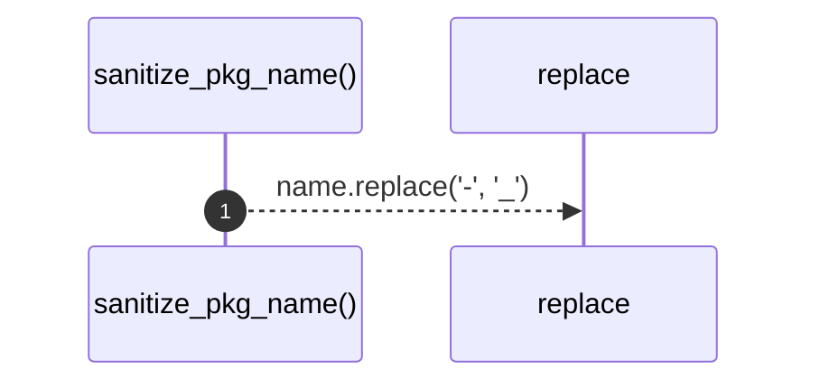

# `robby_extract::typescript::sanitize_pkg_name`

[Self-model](../../README.md) · [typescript](index.md)

| | |
|---|---|
| kind | `code.function` |
| signature | `fn sanitize_pkg_name(name: &str) -> String` |
| location | [`crates/robby-extract/src/typescript.rs:132`](../../../../crates/robby-extract/src/typescript.rs#L132) |
| provenance | extractor · confidence 1.00 |

```rust
fn sanitize_pkg_name(name: &str) -> String {
    name.replace('-', "_")
}
```



1 steps · 0 observed · 1 possible only

## Referenced by

- calls ← [`robby_extract::typescript::package_at`](package-at.md)

